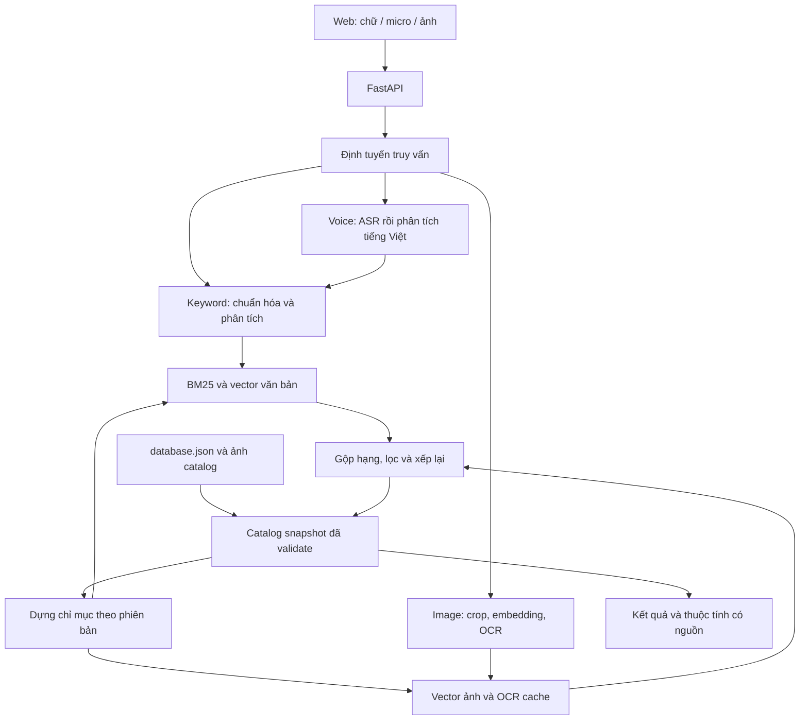

# VNStore — Kế hoạch demo khám phá và tìm kiếm sản phẩm Việt

Ngày lập: 09/10/2026. Định hướng đã xác nhận: demo trước, ưu tiên mã nguồn mở và chi phí thấp.

Tài liệu này là kế hoạch triển khai, chưa phải hệ thống đã chạy. Chưa thu thập catalog, chưa xây database.json có dữ liệu thực và chưa thực hiện benchmark; mọi ngưỡng dưới đây là mục tiêu đề xuất, không phải kết quả đo. Model chỉ được chọn sau thử nghiệm trên dữ liệu của VNStore.

## 1. Sản phẩm và giới hạn demo

Xây một website ưu tiên khám phá sản phẩm Việt: xem ảnh, đọc thông tin nguồn gốc, duyệt thương hiệu/làng nghề, tìm bằng chữ, giọng nói và ảnh. Ba kiểu tìm kiếm dùng chung catalog, bộ lọc và trang kết quả.

Phạm vi đầu tiên:

- Trang chủ, danh mục, danh sách thương hiệu/làng nghề, chi tiết sản phẩm, tìm kiếm và sản phẩm tương tự.
- Thẻ sản phẩm có ảnh, tên, giá nếu biết, thương hiệu/nhà sản xuất, nhãn nguồn gốc có căn cứ.
- Bộ lọc danh mục, khoảng giá, chất liệu, màu, thương hiệu, nơi sản xuất, làng nghề và loại bằng chứng về nguồn gốc.
- Chi tiết có nhiều ảnh, thuộc tính, biến thể, câu chuyện ngắn được biên tập từ nguồn, ngày kiểm tra thông tin và đường dẫn nguồn.
- Giao diện ưu tiên điện thoại; có trạng thái đang tải, không có kết quả, model không sẵn sàng, micro bị từ chối và ảnh không hợp lệ.
- Có thể lưu yêu thích trên thiết bị. Thanh toán, đơn hàng, kho thời gian thực, marketplace nhiều người bán và tài khoản chưa thuộc demo đầu tiên.

Ba hành trình bắt buộc:

1. Gõ “binh gom bat trang duoi 500k” → hiểu loại sản phẩm, xuất xứ cần tìm và giá; cho xem cách hệ thống diễn giải.
2. Nói “tìm cho mình cái túi cói dưới ba trăm nghìn” → hiện bản chép lời có thể sửa → kết quả và bộ lọc tương ứng.
3. Chụp một chiếc giỏ mây → chọn/cắt vật thể → tìm mẫu giống hoặc tương tự → nhập thêm “có quai, dưới 400k”.

Ảnh giống nhau không chứng minh nguồn gốc Việt. Nhãn nguồn gốc luôn lấy từ catalog đã được kiểm tra.

## 2. Quy định “sản phẩm Việt” trước khi thu thập

Không dùng một cờ is_vietnamese để gộp các khái niệm khác nhau. Mỗi sản phẩm có các thuộc tính độc lập:

| Thuộc tính | Ý nghĩa | Yêu cầu dữ liệu |
|---|---|---|
| Thương hiệu Việt | Thương hiệu có nguồn gốc Việt theo bằng chứng được lưu | Hồ sơ chính thức của thương hiệu; không suy ra từ tên tiếng Việt |
| Sản xuất tại Việt Nam | Sản phẩm/SKU được sản xuất tại Việt Nam | Trang sản phẩm, nhãn hoặc tài liệu nhà sản xuất |
| Nguyên liệu Việt | Nguồn nguyên liệu Việt được công bố | Có thể chỉ xác nhận một phần nguyên liệu |
| Thủ công/truyền thống | Kỹ thuật, nghề hoặc dòng sản phẩm truyền thống | Bằng chứng cho kỹ thuật/làng nghề, tránh suy đoán từ hình ảnh |
| Làng nghề/địa phương | Quan hệ cụ thể với nơi sản xuất hoặc di sản nghề | Giữ tên gốc theo nguồn, mã địa lý chuẩn và thời điểm xác minh |

Dùng ba giá trị true/false/unknown cho thuộc tính cần xác minh. Unknown không đồng nghĩa false. Tách “nhà sản xuất công bố” và “đã kiểm tra nguồn”; việc kiểm tra một website không phải xác thực độc lập hàng hóa.

Catalog demo chỉ nhận sản phẩm có ít nhất một tiêu chí Việt có nguồn. Nhóm nổi bật ưu tiên sản phẩm sản xuất tại Việt Nam kết hợp thương hiệu/nghề Việt đã có bằng chứng. Không tạo điểm “thuần Việt 98%”; hiển thị từng căn cứ cụ thể.

Ưu tiên 5 nhóm, mỗi nhóm khoảng 60 sản phẩm: gốm sứ; mây tre/cói; dệt may và phụ kiện truyền thống; đồ gỗ/sơn mài/trang trí thủ công; thực phẩm đóng gói/đặc sản. Có thể điều chỉnh cơ cấu theo nguồn ảnh hợp lệ. Đây là hạn ngạch thu thập, không phải khẳng định mọi sản phẩm trong nhóm có nguồn gốc Việt.

## 3. Công việc đầu tiên: database.json

### 3.1. Quy mô và nguồn dữ liệu

Đợt đầu nhập 30 sản phẩm để kiểm chứng cấu trúc, sau đó mở rộng 300 sản phẩm thật. Mỗi sản phẩm có tối thiểu một ảnh được phép sử dụng; mục tiêu 2–4 ảnh cho tập benchmark. Mở rộng 1.000 sản phẩm chỉ sau khi pipeline và nhãn đánh giá đã ổn định.

Nguồn ưu tiên: website chính thức của thương hiệu/nhà sản xuất, catalog nghệ nhân/hợp tác xã có quyền sử dụng, dữ liệu nhà cung cấp hoặc ảnh tự chụp. Danh sách nguồn là đầu việc của giai đoạn thu thập, chưa coi là đã được xác minh.

Quy trình: chọn nguồn → lưu URL và thời điểm → trích xuất thông tin → xác định quyền dùng ảnh → chuẩn hóa → kiểm tra bằng mắt → nhập JSON → kiểm tra schema và tham chiếu → tạo chỉ mục.

Không bịa giá, đánh giá sao, tồn kho hoặc chứng nhận. Thiếu giá dùng null và UI “Liên hệ”; không dùng 0. Giá có đơn vị VND, ngày ghi nhận, giá gốc/khuyến mãi khi nguồn phân biệt rõ. Không sao chép dài mô tả của bên bán; biên tập mô tả ngắn dựa trên thuộc tính có nguồn. Sản phẩm chưa đủ ảnh/nguồn vào trạng thái draft.

### 3.2. Hợp đồng dữ liệu dự kiến

Các collection cấp cao:

```json
{
  "schema_version": "1.0.0",
  "catalog_version": "seed-001",
  "locale": "vi-VN",
  "currency": "VND",
  "updated_at": null,
  "categories": [],
  "brands": [],
  "makers": [],
  "places": [],
  "sources": [],
  "products": [],
  "search_dictionary": {
    "synonyms": [],
    "regional_terms": [],
    "brand_aliases": [],
    "unit_aliases": []
  }
}
```

Đây là cấu trúc minh họa, không phải catalog hoàn tất. Khi triển khai sẽ tạo database.schema.json và database.json thực sự.

| Nhóm trường của product | Nội dung |
|---|---|
| Định danh | id ổn định, slug, name_vi, status, category_id, brand_id nullable, maker_id |
| Nội dung | short_description_vi, description_vi, aliases, tags, intended_uses |
| Thuộc tính | materials[], colors[], dimensions theo đơn vị chuẩn, craft_techniques[], motifs[] |
| Giá/biến thể | variants[] với sku, thuộc tính biến thể, price_vnd nullable, price_source_id, observed_at; availability = unknown nếu chưa biết |
| Nguồn gốc | brand_origin_country, manufacturing_country, material_origins[], place_ids[], craft_village_id nullable |
| Bằng chứng | origin_claims[] gồm claim_type, value, status, source_ids[], checked_at; certifications[] chỉ nhập khi có căn cứ |
| Ảnh | images[] gồm id, local_path, source_url, alt_vi, view_type, variant_id nullable, sha256, usage_rights |
| Truy xuất | source_ids[], created_at, updated_at, reviewed_at |

brands/makers lưu tên chuẩn, bí danh có căn cứ, URL chính thức và nguồn. places giữ tên theo nguồn và tên chuẩn hóa để hỗ trợ địa danh cũ/mới; tên địa phương không bị ghi đè làm mất lịch sử.

sources lưu id, URL, tổ chức phát hành, loại nguồn, thời điểm lấy, ghi chú quyền sử dụng và phần thuộc tính được hỗ trợ. search_dictionary lưu quan hệ có loại và ngữ cảnh: đồng nghĩa, từ rộng/hẹp, cách gọi vùng miền hoặc tên dễ nhầm. “Mây” và “tre”, “gốm” và “sứ” không tự động coi là cùng một vật liệu.

### 3.3. Đọc trực tiếp từ JSON và tính nhất quán

- Backend đọc và validate database.json khi khởi động, tạo snapshot và map product_id → product. API chi tiết, danh mục và kết quả đều lấy thông tin hiển thị từ snapshot này.
- Không nhập catalog vào một database khác trong demo. Frontend gọi API; không tải toàn bộ JSON mỗi lần tìm.
- BM25, vector và OCR cache là dữ liệu dẫn xuất, chỉ lưu dưới artifacts/indexes/. Xóa chúng vẫn có thể dựng lại từ JSON và ảnh tham chiếu.
- Manifest chỉ mục gồm SHA-256 nội dung catalog, checksum ảnh, model_id/revision, cấu hình tiền xử lý và thời điểm dựng. Thay dữ liệu hoặc model phải dựng lại phần liên quan.
- Nạp catalog và index theo cùng phiên bản, chuyển snapshot nguyên khối; không ghép metadata mới với vector cũ. Index lỗi thì dùng tìm kiếm keyword trên snapshot hợp lệ.
- Chỉnh catalog qua script kiểm tra rồi ghi file tạm và thay file nguyên khối; demo dùng một người ghi. Khi cần nhiều người ghi hoặc giao dịch thật, lập đợt chuyển cơ sở dữ liệu riêng.

Nghiệm thu dữ liệu: không trùng ID/SKU; mọi tham chiếu hợp lệ; không có ảnh mất file cho sản phẩm published; không có nhãn nguồn gốc thiếu source_id; toàn bộ sản phẩm published có tên, danh mục và nguồn. Báo cáo tỷ lệ thiếu dữ liệu và phát hiện trùng ảnh bằng hash/perceptual hash.

## 4. Kiến trúc demo tiết kiệm

Đề xuất giao diện React + TypeScript + Vite; backend Python + FastAPI; xử lý ML bằng PyTorch/Transformers và adapter riêng từng model. Đây là lựa chọn triển khai, không cần dịch vụ cloud trả phí để chạy luồng keyword.



Với vài trăm sản phẩm, vector chuẩn hóa + cosine bằng NumPy là đủ để đo baseline chính xác. Chỉ cân nhắc FAISS khi đo được nhu cầu; chưa cần Elasticsearch, Qdrant, Redis hay microservices. Không cộng trực tiếp cosine của model khác nhau với điểm BM25: thử Reciprocal Rank Fusion (RRF), tinh chỉnh trên validation.

API dự kiến: GET /products, GET /products/{id}, GET /facets, GET /suggest, POST /search, POST /search/voice, POST /search/image, GET /health. Response có product_id, interpreted_query, applied_filters, warnings và timings; metadata sản phẩm được ghép từ catalog. Thông tin chẩn đoán model chỉ hiện trong trang benchmark/dev.

Tách API và worker inference nặng trong cùng máy khi cần. Tải model theo nhu cầu, chỉ giữ model được chọn khi demo; không nạp tất cả ứng viên cùng lúc. CPU phục vụ keyword và catalog. GPU thuê ngắn hạn hoặc notebook có GPU phục vụ benchmark/fine-tune; thời lượng cấp GPU miễn phí không được coi là bảo đảm.

## 5. Keyword search phục vụ tiếng Việt

Giữ nguyên truy vấn gốc; tạo các nhánh xử lý có thể kiểm tra:

1. Unicode NFC, chuẩn hóa khoảng trắng/chữ hoa, giữ bản có dấu.
2. Tạo thêm trường không dấu, chuyển đ→d cho tìm kiếm linh hoạt; không thay bản gốc. Khớp có dấu chính xác được ưu tiên.
3. BM25 nhiều trường: tên, thương hiệu/SKU, aliases, chất liệu, làng nghề, danh mục và mô tả. Thử tách từ so với token âm tiết + character n-gram; không mặc định tokenizer nào tốt hơn.
4. Autocomplete theo catalog; xử lý lỗi gõ, Telex/VNI và thiếu dấu bằng ứng viên giới hạn. Với tên riêng hoặc SKU, ưu tiên exact/prefix và không sửa cưỡng bức.
5. Từ điển có ngữ cảnh: “ly/cốc”, “chén/bát” tùy vùng và danh mục; từ đồng nghĩa không làm mất nghĩa gốc. Mơ hồ thì đề xuất cách hiểu.
6. Parse tiền và đơn vị: “300k”, “ba trăm nghìn”, “1 triệu rưỡi”, “nửa ký”; giữ toán tử dưới/trên/từ–đến. Ví dụ “dưới 500k” là price < 500000. “Không lấy nhựa”, “trừ màu đỏ” là ràng buộc phủ định.
7. Thử semantic retrieval với BGE-M3 cho truy vấn nhu cầu như “quà tặng mẹ làm thủ công”, rồi gộp với BM25; chỉ giữ nếu cải thiện đủ so với độ trễ. BGE-M3 là ứng viên đa ngôn ngữ, chưa có bảo đảm cho catalog này. [Model card BGE-M3](https://huggingface.co/BAAI/bge-m3)
8. Ràng buộc người dùng nhập rõ là hard filter; thuộc tính suy đoán là soft boost hoặc chip để xác nhận. Sản phẩm giá unknown không lọt vào kết quả khẳng định đáp ứng khoảng giá.

Xếp hạng ưu tiên độ liên quan. Trong tập phù hợp, có thể ưu tiên bằng chứng nguồn gốc đầy đủ, đa dạng thương hiệu và loại bỏ trùng biến thể. Không đẩy hàng kém liên quan lên chỉ vì “Việt hơn”. Không có kết quả thì giải thích bộ lọc nào đang hạn chế và cho người dùng chủ động nới.

## 6. Voice search: thử model rồi tối ưu

Luồng: ghi âm khi người dùng bấm → kiểm tra/giải mã audio → VAD và resample theo model → ASR → bản chép lời gốc → chuẩn hóa truy vấn và trích bộ lọc → keyword/hybrid search. Hiện transcript sửa được trước hoặc cùng kết quả; có nút ghi lại.

### 6.1. Các ứng viên

| Ứng viên | Vai trò thử nghiệm |
|---|---|
| vinai/PhoWhisper-small | Ứng viên tiết kiệm, đã được phát triển riêng cho tiếng Việt |
| vinai/PhoWhisper-medium | Đo lợi ích chất lượng so với small và chi phí tăng |
| Qwen/Qwen3-ASR-0.6B | Ứng viên khác họ mô hình, kích thước vừa phải |
| Qwen/Qwen3-ASR-1.7B | Ứng viên chất lượng; thử nếu tài nguyên cho phép |

PhoWhisper có nhiều kích thước và được fine-tune trên dữ liệu nhiều giọng Việt; Qwen3-ASR công bố hỗ trợ tiếng Việt. Đây chỉ là cơ sở lập shortlist. [PhoWhisper](https://github.com/VinAIResearch/PhoWhisper), [Qwen3-ASR](https://huggingface.co/Qwen/Qwen3-ASR-0.6B)

Mỗi checkpoint cần kiểm tra license, revision và khả năng chạy trước khi benchmark. Không đồng nhất “mã nguồn mở” với mọi checkpoint đều phù hợp triển khai thương mại. Demo không phụ thuộc Web Speech API vì khó cố định model, môi trường và tính tái lập.

### 6.2. Dữ liệu và cải tiến cho người Việt

- Bộ demo 600 câu do 40 người nói, khoảng 15 câu/người, cân đối tương đối Bắc/Trung/Nam; báo cáo thêm nhóm giọng cụ thể nếu đủ mẫu. Đa dạng tuổi trưởng thành, thiết bị, tốc độ và môi trường yên/tạp âm/quán cà phê/ngoài đường.
- Bao gồm tên thương hiệu, địa danh/làng nghề, từ thủ công, giá, đơn vị, phủ định, câu nói tự nhiên và tiếng Anh xen tiếng Việt. Có clip im lặng, chỉ tiếng ồn, câu bị cắt và nhu cầu không có trong catalog.
- Người nghe chép lời và kiểm tra lại tên riêng; gán nhãn intent, brand, category, material, price, negation và sản phẩm phù hợp.
- Dùng vocabulary từ catalog để contextual biasing khi model hỗ trợ; benchmark bản gốc và bản có bias riêng. Không cung cấp transcript hoặc đáp án test trong prompt.
- Hậu xử lý tên gần âm chỉ sinh gợi ý có căn cứ; không tự đổi “lụa” thành “lúa” hoặc tên thương hiệu khác chỉ vì thông dụng hơn.
- Đánh giá VAD, denoise, chuẩn hóa số, từ điển thương hiệu, n-best/rescoring nếu model có hỗ trợ. Không áp dụng denoise mặc định nếu làm mất phụ âm/dấu thanh.
- Fine-tune chỉ sau phân tích lỗi và khi có tập train đủ lớn, có quyền sử dụng; vài trăm câu đánh giá không đủ để mặc định fine-tune hiệu quả. TTS và audio tăng cường chỉ bổ sung train, không thay test người thật.

## 7. Image search: ảnh thật và hiểu thuộc tính Việt

Phân biệt ba nhiệm vụ: tìm đúng SKU có trong catalog; tìm cùng loại/tương tự khi không có SKU; ảnh + yêu cầu tiếng Việt. Cần báo cáo riêng, không dùng accuracy phân loại ảnh làm thước đo tìm kiếm.

### 7.1. Các ứng viên

| Ứng viên | Nhiệm vụ chính |
|---|---|
| OpenCLIP ViT-B-32, laion2b_s34b_b79k | Baseline image-to-image nhẹ tương đối; text encoder không mặc định hiểu tốt tiếng Việt |
| google/siglip2-base-patch16-224 | Image-to-image và image/text đa ngôn ngữ |
| facebook/dinov2-base | Baseline đặc trưng thị giác cho hình dáng/hoa văn; không dùng như text encoder |
| minhnguyent546/ViCLIP-OT | Ứng viên đối chiếu ảnh–văn bản tiếng Việt, cần kiểm tra khả năng tái lập |

Các model có checkpoint hoặc hướng dẫn chính thức để dựng thử. ViCLIP-OT được nghiên cứu cho retrieval tiếng Việt, nhưng kết quả trong paper không chứng minh nó tốt nhất trên đồ thủ công/bao bì của VNStore. [OpenCLIP](https://github.com/mlfoundations/open_clip), [SigLIP 2](https://huggingface.co/google/siglip2-base-patch16-224), [DINOv2](https://github.com/facebookresearch/dinov2), [ViCLIP-OT](https://huggingface.co/minhnguyent546/ViCLIP-OT)

### 7.2. Pipeline và cải tiến

1. Sửa orientation, kiểm tra ảnh hợp lệ, resize theo model. Người dùng chọn vùng vật thể khi ảnh có nhiều đồ; full-image là baseline.
2. Mỗi sản phẩm có nhiều góc ảnh; tạo embedding cho từng ảnh và gộp kết quả theo product_id để ảnh trùng không chiếm hết top K.
3. OCR nhãn/bao bì → tìm tên thương hiệu và keyword trong catalog → gộp hạng với kết quả thị giác. Thử PaddleOCR với model Latin hỗ trợ tiếng Việt; đo lỗi trên bao bì thật thay vì mặc định OCR luôn đúng. [PaddleOCR multilingual](https://github.com/PaddlePaddle/PaddleOCR/blob/main/docs/version3.x/algorithm/PP-OCRv5/PP-OCRv5_multi_languages.en.md)
4. Cho bổ sung văn bản tiếng Việt: “giống mẫu này nhưng màu xanh”, “bằng tre”, “dưới 500k”. Parse bộ lọc rồi retrieval/xếp hạng; không cộng vector thuộc hai không gian embedding khác nhau.
5. Mô tả ảnh và metadata dùng từ vựng địa phương, chất liệu, kỹ thuật, hoa văn đã được gán đúng. Ví dụ phân biệt mây/tre/cói, sơn mài/gỗ sơn, dệt/thêu; ưu tiên dữ liệu của nghệ nhân/nhà sản xuất.
6. Thu ảnh query thực: điện thoại, nền phức tạp, ảnh chụp màn hình, ánh sáng vàng, che một phần, nhiều vật thể và bao bì có chữ có dấu. Cần ảnh âm tính ngoài catalog và ảnh hàng tương tự nhưng sai vật liệu/nguồn gốc.
7. Thử từng cải tiến: crop, multi-view, OCR fusion, image+text, hard negatives, fine-tune tương phản khi đủ dữ liệu. Crop/remove-background có thể làm mất quai túi hoặc ngữ cảnh, phải đo ablation.

Không dùng caption do model sinh làm sự thật về nhãn hàng, chất liệu hay xuất xứ. Độ tương đồng thấp thì hiển thị “mẫu tương tự” hoặc yêu cầu ảnh rõ hơn; không khẳng định “đúng sản phẩm”. Với ảnh độc lập, hỗ trợ người Việt chủ yếu nằm ở coverage sản phẩm Việt, OCR tiếng Việt, thuật ngữ và UI; không phải chỉ chọn model có tên tiếng Việt.

## 8. Thiết kế benchmark trước khi chạy

### 8.1. Bộ dữ liệu tối thiểu cho demo

| Bộ | Quy mô mục tiêu | Cách chia |
|---|---|---|
| Keyword | 600 truy vấn có người kiểm tra | Train/dev/test 60/20/20, nhóm theo ý định và các biến thể paraphrase |
| Voice | 600 clip / 40 người | 24/8/8 người cho train/dev/test; không trùng người nói |
| Image | 600 ảnh query độc lập / khoảng 200 họ sản phẩm | 120/40/40 họ sản phẩm cho train/dev/test; nhóm theo SKU/họ và phiên chụp |
| Image + text | 120 truy vấn ghép, là tập bổ sung | Nhãn truy vấn chỉnh sửa tiếng Việt; không dùng làm train nếu đã dành cho test |

Giữ cân đối nhóm vùng miền/danh mục theo khả năng dữ liệu. Tập ảnh gallery là ảnh catalog cố định; ảnh query test phải khác ảnh gallery và khác phiên chụp/nguồn gần trùng. Gallery có sản phẩm test để tìm được chúng là hợp lệ; không dùng cặp query-label test hoặc ảnh họ sản phẩm test để fine-tune. Ảnh sinh, crop hoặc augment từ cùng một ảnh gốc luôn nằm cùng split.

Bổ sung các ca không có kết quả trong từng tập, khoảng 10–15%, nhưng báo cáo riêng. 120 mẫu test/modality chỉ đủ kết luận thăm dò của demo; không tuyên bố tổng quát cho mọi người Việt. Nếu cần kết luận nghiên cứu/vận hành, mở rộng test độc lập, đặc biệt giọng ít mẫu và sản phẩm mới.

Relevance keyword/similar-image: 0 không liên quan, 1 liên quan yếu, 2 phù hợp, 3 rất phù hợp. Exact-SKU có nhãn riêng. Pool top kết quả của mọi baseline cộng mẫu ngẫu nhiên để gán nhãn; hai người đánh giá độc lập một phần dữ liệu và phân xử bất đồng. Trường hợp relevance chưa được đánh giá không mặc định là không liên quan khi so sánh model mới.

### 8.2. Metric

| Thành phần | Metric chính | Metric bổ sung |
|---|---|---|
| Keyword | nDCG@10, Success@5 | MRR@10 cho truy vấn tìm món cụ thể, Recall@20, tỷ lệ không có kết quả sai |
| Voice transcription | WER, CER | Entity F1, accuracy giá/đơn vị/phủ định, tỷ lệ hallucination trên im lặng |
| Voice end-to-end | nDCG@10, Success@5 | Suy giảm so với tìm bằng transcript chuẩn; kết quả theo giọng/thiết bị/tiếng ồn |
| Image exact | Recall@1/5/10 theo product/SKU | MRR@10, nhầm giữa các biến thể |
| Image similar | nDCG@10, mAP@10 | Recall@10 theo nhãn phù hợp |
| Image + text | nDCG@10, Success@5 | Tỷ lệ vi phạm màu/chất liệu/giá được yêu cầu |
| No-match | Precision/recall hoặc F1 của quyết định không có món phù hợp | False accept rate; hiệu chỉnh threshold trên dev |
| Vận hành | Latency p50/p95, peak RAM/VRAM | RTF của ASR, kích thước model/index, thời gian cold start và chi phí/query |

WER = (thay thế + xóa + chèn) / số token tham chiếu. Tiếng Việt có nhiều từ đa âm tiết, vì vậy phải cố định cách token hóa; báo cáo rõ WER theo token cách trắng và CER giữ dấu. Có bản raw và bản normalized theo một chính sách dùng chung: case, dấu câu, viết số; không bỏ dấu để làm điểm tốt hơn. Không so trực tiếp WER giữa hai bộ test/chính sách khác nhau.

Success@5 là tỷ lệ truy vấn có ít nhất một sản phẩm phù hợp trong top 5, chỉ tính query có đáp án; no-match đo riêng. Với nDCG, công bố gain 2^relevance-1 và discount log2(rank+1). Với mAP@10, công bố ngưỡng relevance dương và mẫu số min(số relevant đã gán, 10). Gallery phải giữ nguyên giữa các model.

### 8.3. Quy trình lựa chọn

1. Khóa catalog, split, rubric và cấu hình máy. Chạy BM25 và các model nguyên bản làm baseline.
2. Vòng sàng lọc trên dev subset 60–100 mẫu/modality: chạy tối thiểu 3 cấu hình voice và 3 image nếu có thể; lưu mọi lỗi/OOM. Không loại model chỉ vì điểm vài ca dễ.
3. Chọn 2 ứng viên mỗi modality bằng chất lượng và tài nguyên; chạy toàn bộ dev và các ablation có ngân sách tuning ngang nhau. Voice so model với cùng search backend; image so cùng gallery, dedup và tập query.
4. Chốt model, hyperparameter và pipeline trên dev. Chạy locked test một lần để báo cáo; dùng paired bootstrap theo người nói/họ sản phẩm để ước lượng CI 95%, nêu hạn chế mẫu nhỏ.
5. Đánh giá từng phân nhóm và tác vụ. Không chọn model chỉ vì trung bình cao nếu giá/phủ định sai hoặc nhóm giọng bị giảm mạnh.
6. Chọn trong tập phương án đáp ứng giới hạn RAM/VRAM/latency. Ưu tiên Success@5/nDCG thực tế; nếu chênh lệch nằm trong bất định thì chọn model nhỏ/rẻ hơn. Có thể chọn voice và image từ hai họ model khác nhau.
7. Sau khóa test, mọi chỉnh sửa dựa trên lỗi test phải được xác nhận bằng test mới hoặc ghi rõ là đánh giá khám phá; không tiếp tục tuning rồi gọi đó là test độc lập.

Đo offline cùng máy, batch=1 cho interactive, cùng concurrency đã khai báo. Warm-up rồi đo đủ lượt lặp; báo cáo cold start riêng. Đo end-to-end thực ở mạng nội bộ riêng với độ trễ inference. Voice latency tính từ lúc kết thúc nói/bấm dừng đến khi có kết quả, không cộng thời gian người dùng nói; báo cáo upload và xếp hàng riêng.

Mỗi run lưu model/revision/license, code commit, dataset và catalog hash, seed, preprocessing, decoder, precision, thiết bị, phiên bản thư viện, per-query predictions, metrics và lỗi. Model quantized phải đo lại chất lượng; không lấy điểm full precision gán cho bản quantized.

### 8.4. Mục tiêu demo ban đầu

- Keyword: Success@5 ≥ 85% trên query có đáp án; p95 ≤ 500 ms với 300 sản phẩm.
- Voice: Success@5 giảm không quá 10 điểm phần trăm so với transcript chuẩn; accuracy giá/phủ định ≥ 90%; mục tiêu p95 ≤ 3 giây cho clip ngắn ≤ 8 giây trên cấu hình máy được chốt.
- Image: Recall@5 exact ≥ 80%, mục tiêu nDCG@10 similar ≥ 0,70 và p95 ≤ 2 giây trên cấu hình máy được chốt.
- Chênh lệch Success@5 giữa nhóm giọng mục tiêu ≤ 10 điểm phần trăm; luôn kèm số mẫu và khoảng bất định.
- Không có sản phẩm vi phạm hard filter rõ ràng trong bộ regression; mọi trường hợp unknown được xử lý có chủ đích.

Các mốc là giả thuyết nghiệm thu để điều chỉnh sau pilot, chưa phải cam kết hiệu năng. Không ép đạt bằng cách xóa các mẫu khó. Nếu CPU không đạt voice/image, cho phép demo inference trên GPU ngắn hạn hoặc giảm model sau khi đo lại.

## 9. Lộ trình 6–8 tuần có điều kiện

Ước lượng cho hai người có thể chia fullstack và ML/data, cùng hỗ trợ thu/gán nhãn. Một người hoặc khó thu ảnh/audio thật sẽ cần thêm thời gian; chất lượng dữ liệu là phụ thuộc lớn nhất.

| Giai đoạn | Công việc | Điều kiện hoàn thành |
|---|---|---|
| Tuần 1 | Taxonomy, schema, nguồn; 30 bản ghi thật rồi mở rộng 300 | database.json validate được, nguồn/ảnh hợp lệ, có báo cáo thiếu dữ liệu |
| Tuần 2 | Catalog UI/API, BM25, bộ lọc, normalize tiếng Việt | Luồng xem/tìm keyword chạy trực tiếp từ JSON, baseline có số đo |
| Tuần 2–3 | Thu và gán nhãn benchmark, khóa splits | Không trùng người/ảnh gốc giữa split, rubric được rà soát |
| Tuần 3–4 | Adapter và sàng lọc các model voice/image | Bảng metrics thật, per-query predictions, chi phí/tài nguyên |
| Tuần 5 | Tối ưu ngôn ngữ, OCR/crop/fusion, ablation | Chứng minh cải thiện trên dev, chọn ứng viên cuối |
| Tuần 6 | Tích hợp giao diện voice/image, benchmark locked test | Báo cáo lựa chọn model và demo end-to-end |
| Tuần 7–8 dự phòng | Bổ sung ca khó, tối ưu inference, hoàn thiện demo | Regression qua; tài liệu chạy lại; test mới nếu đã sửa theo test cũ |

Phân bổ ngân sách: tận dụng máy hiện có cho catalog/keyword; precompute ảnh một lần mỗi model; chạy inference tuần tự; chỉ thuê GPU theo giờ cho sàng lọc hoặc fine-tune có lý do. Pilot ghi GPU-hours, thời gian gán nhãn và chi phí lưu trữ rồi mới ước lượng tổng tiền. Không bắt đầu huấn luyện model từ đầu.

## 10. Các tệp và đầu ra khi triển khai

```text
VNStore/
  PLAN.md
  database.json
  database.schema.json
  assets/products/
  backend/app/{catalog,search,voice,image}/
  frontend/
  scripts/{validate_catalog,build_indexes}/
  benchmarks/{keyword,voice,image}/
  benchmarks/splits/
  experiments/configs/
  experiments/results/
  reports/{data_quality,benchmark,model_selection}/
  artifacts/indexes/
```

Cấu trúc trên là dự kiến. Không lưu vector lớn hoặc dữ liệu audio người dùng vào database.json. Raw audio/ảnh benchmark có manifest và quyền sử dụng riêng; chỉ chia sẻ artifact khi người tham gia/nguồn ảnh cho phép.

Đầu ra nghiệm thu gồm catalog thật; schema/validator; website chạy được; script rebuild index; script benchmark tái lập; bảng so sánh ít nhất 3 cấu hình mỗi modality nếu môi trường cho phép; báo cáo lỗi và lý do chọn model; README chạy local và video/kịch bản demo.

Giới hạn upload theo dung lượng, thời lượng và kích thước ảnh; giải mã xác thực kiểu file, timeout inference và giới hạn hàng đợi. Bỏ metadata ảnh không cần thiết; audio/ảnh truy vấn tạm xóa sau xử lý, việc lưu cho cải tiến phải có lựa chọn rõ ràng. Keyword vẫn hoạt động nếu model nặng lỗi hoặc không có GPU.

Trình tự ưu tiên: dữ liệu thật có nguồn → catalog và keyword đáng tin cậy → bộ đo tiếng Việt → benchmark voice/image → cải tiến có chứng cứ → chọn model → hoàn thiện demo.
