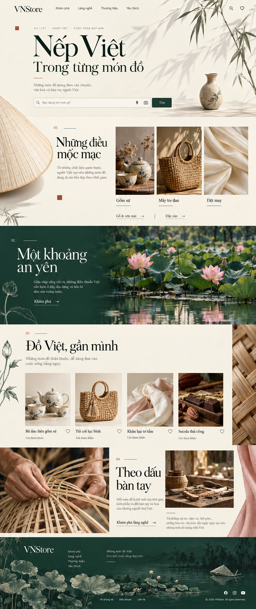
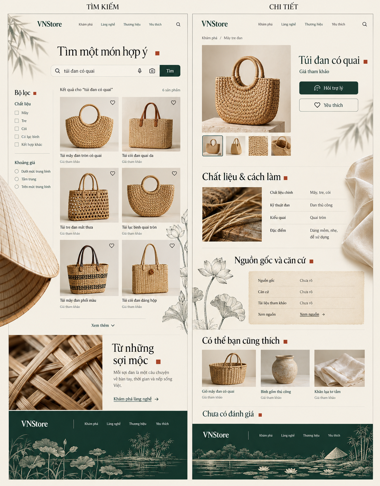
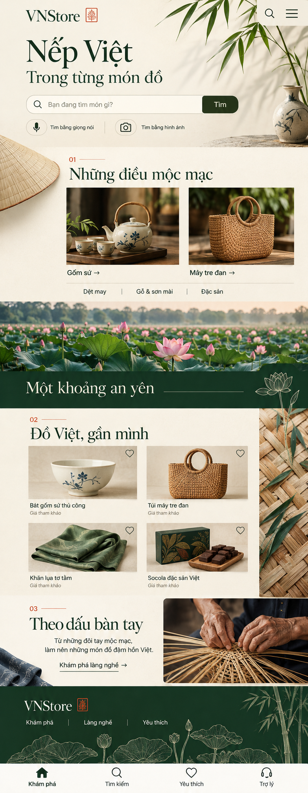
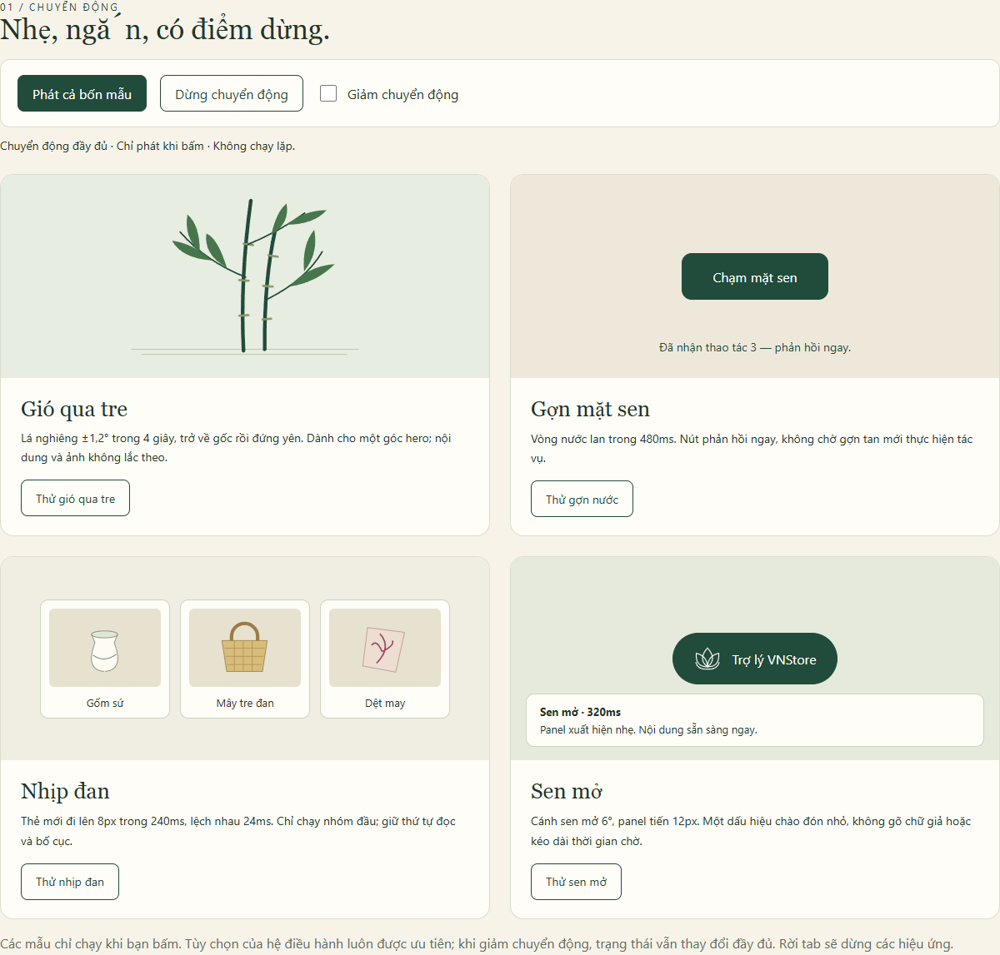

# VNStore — Nếp Việt / Thiết kế nghệ thuật xuyên suốt

Tài liệu thiết kế lại toàn bộ giao diện · 17/10/2026 · **Phiên bản 2 — thay thế định hướng thị giác v1** · Trạng thái: đề xuất thiết kế, chưa triển khai vào ứng dụng.

**Định hướng mới:** một ấn phẩm mỹ thuật Việt Nam có thể tương tác. Bản sắc được xây bằng bố cục bất đối xứng, ảnh vật thể cắt cúp, bóng tre, nét vẽ sen, chất liệu đan và những khoảng màu có nhịp từ đầu đến cuối trang. Mỗi đoạn có một điểm nhìn riêng; hình ảnh Việt xuất hiện ở lề, giữa các nhóm nội dung, trong nhịp chuyển cảnh và ở chân trang. Giá, sản phẩm và căn cứ nguồn gốc vẫn được đọc trên bề mặt yên tĩnh.

**Lý do thay đổi:** v1 dồn tre–nón–sen vào hero; các phần dưới còn là các hàng card thông thường. V2 thay bố cục và cách phân vai hình ảnh trên toàn trang, đồng thời áp dụng hệ sắp đặt này cho các trang con. Các đặc tả dữ liệu, khả năng tiếp cận và nghiệp vụ đã phân tích được bảo toàn.

## 1. Bộ tài liệu và cách xem

| Tệp v2 | Nội dung |
|---|---|
| [Trang chủ toàn chiều dài](docs/design/mockups/05-v2-home-artistic-full.png) | Sáu lớp bố cục, hình ảnh Việt phân bố từ đầu đến footer |
| [Tìm kiếm và chi tiết toàn trang](docs/design/mockups/06-v2-search-product-artistic.png) | Hai trang con cùng ngôn ngữ mỹ thuật, các mô-típ ở nhiều cao độ |
| [Trang chủ mobile toàn chiều dài](docs/design/mockups/07-v2-mobile-artistic-full.png) | Cách rải hình ảnh và đổi nhịp trên màn hình hẹp |
| [Phòng xem thiết kế](docs/design/preview.html) | Xem v2, bản đồ sắp đặt và các mẫu chuyển động; mở offline |
| [Prompt tạo ảnh v2](docs/design/image-prompts-v2.md) | Prompt nguyên văn, công cụ và giới hạn |

**Xem ảnh toàn chiều dài trước khi đánh giá từng khối.** Mục tiêu của v2 là nhịp thị giác xuyên suốt, không chỉ ấn tượng ở màn hình đầu.







Ảnh tạo bằng **imagegen tích hợp**, dùng để duyệt ngôn ngữ tạo hình, tỷ lệ tương đối và nhịp toàn trang. Không dùng các sản phẩm AI, chất liệu, câu mô tả hoặc nguồn trong ảnh làm dữ liệu catalog. Nội dung HTML khi triển khai theo đặc tả và API thật.

**Hiệu chỉnh bắt buộc so với ảnh:** footer ảnh desktop có năm 2024, icon mạng xã hội và vài mục không có trong dự án — bỏ chúng; giữ route thật. Bộ lọc giá như “tầm trung” trong ảnh trang con là chữ minh họa — thay bằng Từ/Đến và facets thật. Bảng thuộc tính trong ảnh không chứng minh vật liệu thực. Dấu vuông đỏ chỉ là điểm nhấn biên tập, không phải dấu xác nhận. Wordmark dùng VNStore thống nhất; không thêm biểu trưng khác cho mobile. Ảnh mobile cố tình phóng đại dải đan để nhìn rõ ý tưởng: khi dựng ở 390px phải thu về giới hạn §3.4, bảo vệ độ rộng card. Không dùng texture giấy thô dưới bảng nguồn gốc. Không làm nón lá trôi như một chiếc thuyền ở footer; bỏ hoặc đặt nằm trên bờ. Mọi phần ảnh vượt vùng chữ phải được cắt lại theo quy tắc khoảng trống.

Các ảnh `01–04` và [prompt v1](docs/design/image-prompts.md) được giữ để đối chiếu lịch sử; **không còn là hướng thiết kế chính**. Bốn mẫu motion v1 vẫn hữu ích cho timing của tương tác nhỏ, nhưng cách phân bố cảnh và bố cục được thay bằng v2.

## 2. Phân tích dự án hiện tại

### 2.1. Phạm vi khảo sát và mức chắc chắn

Đã đọc router, App, stylesheet, các trang nghiệp vụ, component tìm kiếm/giọng nói/ảnh/trợ lý/đánh giá, API types, mã đo hiệu năng, cấu hình E2E và bốn template duyệt dữ liệu offline. Đã đối chiếu trực tiếp `database.json` và xem ảnh browser có sẵn tại [voice-results.png](artifacts/stage6-smoke/stage6_real-local-models-b-27eb9-e-results-and-timing-export-desktop/voice-results.png). Ảnh này là bằng chứng hình thức của lần chạy trước, không đại diện mọi trạng thái của checkout hiện tại.

Đây là **audit mã nguồn và thiết kế**, chưa chạy một phiên kiểm thử toàn bộ ứng dụng hiện tại. Các điểm yếu bên dưới là quan sát từ mã/ảnh lưu, không phải kết luận từ nghiên cứu người dùng. Các chỉ tiêu tốc độ ở §10 là mục tiêu phải đo sau triển khai.

### 2.2. Sản phẩm và nền tảng thật

| Hạng mục | Hiện trạng đã đối chiếu | Hệ quả thiết kế |
|---|---|---|
| Mục đích | Demo khám phá và tìm kiếm sản phẩm Việt | Ưu tiên tìm hiểu, so sánh, lưu yêu thích, hỏi trợ lý |
| Frontend | React + TypeScript + Vite; dependencies hiện chỉ React/React DOM | Có thể triển khai bằng CSS/SVG và API trình duyệt; chưa cần thêm thư viện motion |
| Điều hướng | Hash router trong `frontend/src/router.ts`; đổi path mới cuộn đầu trang | Giữ deep link, lịch sử và bộ lọc URL; chuyển cảnh không được remount toàn bộ ứng dụng |
| Dữ liệu | `seed-007-intended-uses`: 330 sản phẩm, 328 published, 2 draft, 814 bản ghi ảnh; 23 danh mục, 5 gốc; 7 thương hiệu, 6 địa điểm | Số hiển thị phải lấy API theo publication mode; không hard-code 328 vào trang |
| Khám phá | Danh mục, thương hiệu, làng nghề; yêu thích trên thiết bị | Hướng hình ảnh phải bao quát cả gốm, đan, dệt, sơn mài và thực phẩm |
| Tìm kiếm | Chữ + diễn giải truy vấn; voice xác nhận transcript; ảnh + crop + chữ + facets | Ba cách tìm chung ngôn ngữ giao diện nhưng giữ rõ trạng thái từng cách |
| Trợ lý | SSE, gợi ý, đánh giá/so sánh, ba mức đồng ý lưu; trang quản lý ghi nhớ | Có thiết kế đầy đủ cho chờ, stream, lỗi, chế độ cơ bản và quyền dữ liệu |
| Giao dịch | Không có route/API giỏ hàng, đặt hàng, thanh toán | Không đưa “Mua ngay”, phí giao hàng hay thanh toán vào phạm vi redesign |
| Công cụ nội bộ | Thu voice/ảnh, duyệt transcript, diagnostics; thêm HTML duyệt keyword/ảnh/họ/crop offline | “Toàn bộ giao diện” gồm cả các màn hình này; dùng biến thể tập trung vào thao tác |

Năm danh mục gốc: Gốm sứ; Mây tre đan, cói; Dệt may và phụ kiện truyền thống; Đồ gỗ, sơn mài, trang trí thủ công; Thực phẩm đóng gói, đặc sản. Nhãn ngắn trên điều hướng lần lượt: **Gốm sứ / Mây tre đan / Dệt may / Gỗ & sơn mài / Đặc sản**; vẫn giữ tên đầy đủ trong tiêu đề hoặc mô tả truy cập.

### 2.3. Điểm đang tốt cần bảo toàn

- Query parser, bộ lọc cứng, cảnh báo thiếu từ khóa và gợi ý nới điều kiện giúp tìm kiếm có thể giải thích được.
- Giá không biết, nguồn gốc chưa rõ và trạng thái model không sẵn sàng đã có biểu diễn; không biến chúng thành thông tin khẳng định.
- Search/ảnh đã có hủy yêu cầu và chặn kết quả cũ. Crop giữ tỷ lệ, ảnh gửi được chuẩn hóa; bản chép lời cho phép sửa trước khi tìm.
- Có xử lý ảnh lỗi, responsive grid, theme theo hệ thống, trạng thái tải/lỗi và nhiều ca E2E.
- Trợ lý và dữ liệu ghi nhớ có mức đồng ý rõ; reviews hiển thị theo dữ liệu trả về, không tự tạo lời chứng thực.

### 2.4. Vấn đề và quyết định sửa

| Ưu tiên | Quan sát trong mã/ảnh | Tác động | Quyết định |
|---|---|---|---|
| P0 | `HomePage.tsx`: hero chỉ chữ, search và chip | Thiếu ấn tượng Việt Nam ngay điểm vào | Mở đầu bằng chữ lớn và bóng tre; phân bổ nón, sen, chất liệu xuống các chương dưới |
| P0 | `styles.css`: h1 1.5rem, hero 1.75rem; nhiều surface/viền/radius giống nhau | Phân cấp yếu, màn hình dày thông tin | Hệ kiểu chữ, khoảng trắng và mức surface mới |
| P0 | `.card-img img` dùng cover cho mọi sản phẩm | Có thể cắt quai túi, đầu bình, mép khăn | Ảnh catalog mặc định contain; crop chỉ cho ảnh editorial đã duyệt |
| P0 | Voice/camera/chat dùng emoji | Màu và nét khác nhau theo hệ điều hành | SVG nét đồng bộ, giữ accessible name |
| P0 | Reduced motion mới tắt `.rec-dot`; spinner vẫn quay | Chính sách chuyển động chưa đầy đủ | Bộ token motion và chế độ giảm chuyển động xuyên suốt |
| P0 | Search giữ data cũ khi tải nhưng không có chỉ báo rõ cho mọi lượt thay lọc | Người dùng có thể hiểu nhầm kết quả cũ là kết quả mới | `aria-busy`, dòng “Đang cập nhật”, giữ vị trí danh sách |
| P1 | `ProductPage.tsx`: thông tin dài, bảng thuộc tính/nguồn gốc nối tiếp | Khó tìm nhanh thông tin quan trọng | Tóm tắt đầu trang, neo mục, các lớp thông tin nhưng không giấu căn cứ |
| P1 | `AssistantPanel.tsx`: dialog `aria-modal=false` cả khi mobile; tự cuộn cuối mỗi lần messages đổi | Cần rà soát focus và tránh kéo khỏi đoạn đang đọc | Desktop nonmodal, mobile modal; chỉ tự cuộn khi đang gần cuối |
| P1 | `SearchBar`: autofocus trên home; autocomplete chưa gắn đầy đủ id/active descendant | Có nguy cơ bật bàn phím ngay trên mobile; đọc gợi ý kém rõ | Bỏ autofocus khi vào home; hoàn thiện combobox theo bàn phím |
| P1 | Crop hiện chỉ hỗ trợ pointer | Không có thao tác tương đương bằng bàn phím | Thêm dùng cả ảnh/reset và điều khiển vùng chọn bằng phím |
| P1 | Favorites bắt mọi lỗi tải thành null; lưu localStorage có thể thất bại im lặng | Lỗi mạng dễ trông giống danh sách trống | Phân biệt sản phẩm bị gỡ, lỗi kết nối, lỗi lưu trên thiết bị |
| P1 | Trang danh mục là ô chữ, brands/places là danh sách chữ | Thiếu cảm giác khám phá | Thẻ ảnh có điều kiện, chữ đẹp khi chưa có ảnh được cấp quyền |
| P1 | CSS global chứa cả public, trợ lý và nội bộ; HTML offline có CSS riêng | Dễ lệch phong cách và hồi quy khi sửa | Token chung + CSS theo component + theme nội bộ/offline |

Các chỉnh sửa về focus, trạng thái lỗi, crop bằng phím là phần việc triển khai mới, không được coi là đã có chỉ vì ảnh concept thể hiện giao diện mới.

## 3. Chỉ đạo mỹ thuật: một ấn phẩm Việt có nhịp thở

### 3.1. Cảm xúc và cách tạo hình

Câu mở đầu mới: **“Nếp Việt — Trong từng món đồ”**. Tên sản phẩm vẫn là VNStore. Hướng sáng tạo lấy cảm giác của trang sách mỹ thuật, ảnh tĩnh vật và nét vẽ thực vật trên giấy: có khoảng lặng, điểm nhấn lớn nhỏ, chi tiết được khám phá khi cuộn. Những lựa chọn này là diễn giải thiết kế của dự án, không phải tuyên bố rằng một phong cách đại diện toàn bộ mỹ thuật Việt Nam.

Ba lớp thị giác có chức năng khác nhau:

1. **Lớp đọc:** chữ, giá, input, filter, chứng cứ trên nền đặc; lưới rõ và ổn định.
2. **Lớp sắp đặt:** ảnh thật/cắt hình của vật liệu, nón, đồ gốm, vải, đặt lệch trục có tính toán; giúp chia chương hoặc hướng mắt.
3. **Lớp không khí:** bóng tre, nét mực sen, đường mặt nước, sắc giấy; chỉ xuất hiện trong vùng trống, không phủ đồng loạt mọi component.

Ngôn ngữ kết hợp ảnh vật thể có ánh sáng nhất quán và minh họa nét mảnh. Không thêm một phong cách minh họa mới ở mỗi section. Có thể cắt cúp lớn một vật thể ở mép trang để tạo bất ngờ, nhưng chỉ một điểm như vậy trong một đoạn. Hình ảnh tựa vào lưới và mốc chữ, không trôi ngẫu nhiên như sticker.

### 3.2. Vai trò riêng của từng hình ảnh

| Hình ảnh | Vai trò mỹ thuật | Nơi xuất hiện chính | Cách tái hiện ở nơi khác |
|---|---|---|---|
| Tre | Mở không gian, tạo hướng sáng và nhịp dọc | Bóng/nhánh ở lề mở đầu | Nhịp đường chia, nền xa ở footer; không lặp cùng một PNG góc phải mọi trang |
| Nón lá | Vật thể điêu khắc bằng đường cong và nan | Cắt cúp ở mép chương danh mục, sau hero | Một phần nan ở khoảng trống cuối sidebar; nét nhỏ trên bờ ở footer nếu cần |
| Đầm sen | Khoảng nghỉ giàu cảm xúc ở giữa hành trình | Một đoạn panorama khoảng 35–52% trang chủ | Chuyển thành nét thân/lá ở lề trang chi tiết hoặc empty state, không lặp nguyên ảnh đầm |
| Đan mây/tre/cói | Kết nối giao diện với chất liệu của món đồ | Dải macro ở lề nhóm sản phẩm, đoạn dẫn sang làng nghề | Họa tiết chia phần hoặc nhịp reveal; không dùng nền đan sau tên/giá |
| Lụa/vải | Tạo độ mềm đối lập đường nan/tre | Góc đoạn kể về bàn tay hoặc thuộc tính | Mép vải cắt hẹp tại vùng trống, màu tự nhiên; không thêm vào ảnh sản phẩm thật |
| Men gốm | Tĩnh vật và điểm cân bằng cho chữ lớn | Một vật nhỏ lệch trục ở opening | Ảnh danh mục/sản phẩm; không mặc định sản phẩm nào cũng là gốm |
| Phong cảnh nét mực | Khép trang có dư âm, gắn các chương | Footer rộng, sen ở tiền cảnh và tre ở xa | Phiên bản gọn trong trang tác vụ, không tái dùng bức hero |

Mô-típ liên tục bằng **cách biến đổi vai trò**: tre từ bóng thành đường nét, sen từ cảnh thật thành nét mực, nón từ vật thể lớn thành nhịp nan. Không cần mọi trang có đủ ba hình tre–nón–sen, nhưng từng trang có chủ ý về mở đầu, thân trang và kết thúc.

### 3.3. Bản đồ sắp đặt trang chủ desktop

Các tỷ lệ dưới đây là nhịp của bản concept, không khóa website bằng chiều cao pixel. Trang thật co giãn theo nội dung, text zoom và dữ liệu.

| Chương / khoảng dọc | Bố cục | Sắp đặt hình ảnh | Điểm nghỉ và chuyển đoạn |
|---|---|---|---|
| **Mở — 0–17%** | Chữ lớn chiếm 7 cột, search tối đa 720px; phần phải thoáng | Bóng tre góc phải, một nhánh ngoài lề; tĩnh vật gốm nhỏ thấp bên phải. Không nón/đầm sen tại đây | Phần trắng quanh search rộng; kết thúc bằng khoảng giấy, không banner ảnh tràn màn |
| **01. Những điều mộc mạc — 17–35%** | H1 phụ/đoạn dẫn lệch trái; ba cửa sổ ảnh danh mục khác độ cao ở phải; đủ năm liên kết | Nón thật cắt còn 35–45% thân ở mép trái, neo vào đầu chương; ảnh gốm/đan/vải theo lưới | Mỗi caption có khoảng thở. Nón chỉ lấn lề, không chạm chữ hay ô ảnh |
| **02. Một khoảng an yên — 35–52%** | Nền xanh rừng; phần chữ đặc bên trái, panorama sen 2/3 bên phải | Cảnh đầm sen lớn duy nhất ở giữa trang; nét sen rất mảnh ở điểm tiếp giáp trống | Có đường chân trời và mặt nước; chuyển trực tiếp sang giấy ngà, không sóng SVG lớn rập khuôn |
| **03. Đồ Việt, gần mình — 52–71%** | Tiêu đề rộng; nhóm 4 ảnh sản phẩm, caption thẳng hàng; hàng dưới nếu có | Một dải đan hẹp ở mép phải ngoài container; thân sen nét nhỏ ở mép trái, hai điểm lệch cao độ | Sau mỗi 4–8 món có khoảng trống bằng spacing, không chèn quảng cáo/ảnh lớn vào thứ tự kết quả |
| **04. Theo dấu bàn tay — 71–88%** | Ảnh tay làm nghề lớn trái; chữ giữa; ảnh bàn làm việc nhỏ phải, xếp lệch | Ảnh thao tác thật/ảnh minh họa có nhãn; một mép vải đặt ở rìa khoảng trống | CTA làng nghề đứng riêng; chú thích ảnh tách khỏi lời kể thương mại |
| **Khép — 88–100%** | Footer xanh rừng, chữ và link ở phần trên, cảnh ở chân | Sen nét mực tiền cảnh dưới trái, mặt nước ngang thấp, tre ở xa phải; nón chỉ chi tiết phụ nếu cần | Từ chương nghề đi thẳng vào cảnh rộng; không thêm dãy card hoặc CTA to cuối trang |

**Dàn trải có tiết chế:** tối thiểu ba cao độ có hình ảnh trên trang nội dung dài, gồm một điểm giữa và một đoạn kết. Không cố phủ mọi vùng trắng. Hero chiếm tối đa khoảng 20–25% tổng diện tích hình ảnh trang chủ ở bản concept; phần lớn trải nghiệm hình ảnh nằm bên dưới. Chương sen không phải tuyến nội dung/API mới: CTA mặc định về `#/search`; không gắn câu chuyện sản phẩm hoặc bộ sưu tập không có dữ liệu.

### 3.4. Quy tắc hình học để sắp đặt tinh tế

- **Lưới hai tầng:** nội dung thao tác trong container tối đa 1280px; lớp mỹ thuật được phép rộng tới mép viewport. Mỗi chương có wrapper `position: relative; isolation: isolate`; lớp decor riêng `pointer-events: none`, `aria-hidden`. Chỉ wrapper decor dùng `overflow: clip`, không cắt focus ring hay dropdown của nội dung.
- **Khoảng bảo vệ:** hình đặc/cắt hình cách chữ và control ít nhất 32px desktop, 20px mobile. Bóng rất nhẹ cũng không phủ input, giá và bảng nguồn gốc. Không tính khoảng đệm trong ảnh trong suốt như khoảng thật; đo tới pixel có nội dung.
- **Tỷ lệ:** nón trong chương danh mục rộng 220–320px trên viewport 1440px nhưng phần thấy trong trang chỉ 110–160px; desktop gutter trang trí 64–120px, ưu tiên ngoài container. Macro đan ở rìa rộng 48–80px. Không hy sinh chiều rộng card để giữ đủ vật trang trí.
- **Điểm neo:** tre theo góc trên opening; nón theo mép chương danh mục; sen theo chân phần panorama hoặc heading nguồn gốc; dải đan theo cạnh section sản phẩm; cảnh footer theo cạnh dưới. Không gắn tất cả vào viewport/fixed.
- **Mật độ:** một hình lớn + tối đa một hình nét nhỏ ở mỗi chương; có ít nhất một quãng đọc yên giữa hai hình lớn. Hai mép đối diện không dùng hai hình đặc cùng cao độ.
- **Chiều sâu:** chỉ ba mức (nền, hình decor, nội dung), bóng đổ nhỏ theo cùng hướng sáng; không parallax nhiều lớp, không blur nền lớn, không card bay 3D.
- **Mobile 390px:** nón chỉ thấy 40–60px ở mép chương; macro đan chuyển thành dải ngang 24–40px ở khoảng chuyển chương hoặc mép phải tối đa 16px. Card vẫn ≥156px. Tre giảm còn một nhánh; không chiếm toàn chiều rộng header. Ảnh nghề đổi thành một ảnh lớn + caption; không thu nhỏ nguyên collage desktop.
- **320px/zoom:** khi không đủ khoảng bảo vệ, đổi vật thể thành chi tiết nét trong một dải riêng giữa hai đoạn. Giữ nhịp Việt ở giữa/cuối trang, thay vì ẩn sạch tất cả hình ảnh và chỉ còn hero.
- **Ảnh và chứng cứ:** hình trang trí không nằm trong gallery sản phẩm, không bổ sung hoa văn vào hàng thật. Nét giấy chỉ dùng ở vùng biên tập; bảng nguồn gốc là nền phẳng.

### 3.5. Phân bố bản sắc trên các trang còn lại

| Trang | Mở đầu | Thân trang | Kết trang |
|---|---|---|---|
| Tìm kiếm | Heading gọn, bóng tre xa ô tìm | Một phần nan nón dưới vùng filter; nét sen trong gutter sau nhóm card, không nằm trong DOM danh sách results | Sau nút Xem thêm có dải chất liệu/link làng nghề tùy chọn; footer cảnh gọn |
| Chi tiết sản phẩm | Gallery thật, wordmark, một bóng tre ở vùng trống | Mép vải ngoài thuộc tính; nét sen ngoài bảng nguồn gốc; ảnh cận chất liệu chỉ khi có thật | Sản phẩm tương tự yên tĩnh, footer phong cảnh |
| Làng nghề | Chữ editorial + một ảnh ngữ cảnh có nguồn hoặc minh họa có nhãn | Các ô ảnh/text lệch trục, đan xen cận vật liệu và tên/count thật; tre ở chỗ chuyển nhóm | Một cảnh nước/tre nét mực thấp dưới danh sách |
| Thương hiệu | Chữ lớn, nét mực ngắn như dấu mở trang | Grid logo/chữ rõ; chi tiết vật liệu trong khoảng giữa nhóm, không đè logo | Nét nan nón như dấu kết, footer gọn |
| Yêu thích | Tên trang và cành sen nét nhỏ | Lưới sản phẩm; rìa vải rất mảnh ở một đoạn trống | Empty state có hình riêng; footer cảnh gọn |
| Tìm bằng ảnh | Header gọn, nhánh tre ngoài phần hướng dẫn | Upload/crop nền sạch; họa tiết nan ở dải ngăn hướng dẫn và kết quả | Nét sen cạnh trạng thái rỗng hoặc dưới danh sách |
| Voice/trợ lý | Dấu sen nhỏ trong header | Tin nhắn và transcript tĩnh; một nét cánh sen ở empty state, không nền hoa dưới chat | Đường nước mảnh trên composer; điều khiển rõ |
| Ghi nhớ/nội bộ/offline | Wordmark + đường chia lấy nhịp đốt tre | Chữ/bảng sạch; bản sắc ở token và nhịp spacing | Colophon nhỏ; không hình lớn cản việc duyệt dữ liệu |

**Toàn website có một hệ mỹ thuật, không một tấm ảnh lặp lại.** Trang thao tác dùng mật độ thấp hơn trang khám phá. Hệ này phải được đặt trong shell/component và quy tắc theo route, không chỉ riêng `HomePage`.

## 4. Hệ thiết kế

### 4.1. Màu và theme

| Token đề xuất | Sáng | Tối | Công dụng |
|---|---|---|---|
| `--color-bg` | `#F7F3E8` | `#15271F` | Giấy ngà / đêm trong vườn |
| `--color-surface` | `#FFFDF7` | `#20372C` | Card, input, panel |
| `--color-text` | `#22352B` | `#ECECDF` | Chữ chính |
| `--color-muted` | `#616B60` | `#BBC5B7` | Chữ phụ vẫn đọc rõ |
| `--color-primary` | `#214B3B` | `#B8D4B6` | CTA, active, focus |
| `--color-on-primary` | `#FFFFFF` | `#15271F` | Chữ trên CTA |
| `--color-primary-soft` | `#E7EDE1` | `#2C4839` | Chip, vùng lựa chọn |
| `--color-line` | `#DBDECE` | `#42594A` | Đường chia trang trí |
| `--color-control-border` | `#7B8474` | `#9CAA94` | Biên control cần nhận biết |
| `--color-lotus` | `#AD586C` | `#DEA5B2` | Trang trí, không mặc định làm chữ nhỏ |
| `--color-lotus-text` | `#97485F` | `#E7BAC5` | Chữ điểm nhấn |
| `--color-straw` | `#D8BD7A` | `#CCB982` | Điểm nhấn hình ảnh, không làm chữ phụ |
| `--color-forest-scene` | `#183E33` | `#102A23` | Khoảng sen giữa trang và footer |
| `--color-editorial-mark` | `#A84432` | `#E3A392` | Dấu vuông/đường ngắn biên tập; không là badge chứng nhận |
| `--color-danger` | `#A02D2D` | `#FFA6A0` | Lỗi, thao tác xóa |
| `--color-warning` | `#79530E` | `#F3D48F` | Cảnh báo có nhãn và biểu tượng |

Tính contrast trên các cặp nền đặc theo công thức độ chói WCAG: chữ chính/nền sáng **11,75:1**; chữ phụ/nền sáng **5,01:1**; trắng/CTA xanh **9,84:1**; lotus-text/nền sáng **5,56:1**; biên control/surface **3,83:1**. Màu lotus trang trí chỉ đạt **4,32:1** trên nền sáng, vì vậy không dùng làm chữ nhỏ. Chữ chính/nền tối **13,14:1**, chữ phụ/nền tối **8,78:1**. Đây là kiểm tra token, chưa thay thế audit tất cả trạng thái, opacity và ảnh nền.

Theme theo hệ thống như hiện tại; bổ sung lựa chọn Sáng/Tối/Theo hệ thống ở tiện ích menu nếu triển khai. Theme tối dùng ảnh gốc trong khung tối, không invert ảnh. Viền error/focus và trạng thái selected cần kiểm tra riêng. Mức mục tiêu cho chữ nhỏ là 4,5:1 theo [WCAG 1.4.3](https://www.w3.org/WAI/WCAG22/Understanding/contrast-minimum.html).

### 4.2. Chữ

- **Be Vietnam Pro** cho UI, nhãn, thông tin sản phẩm và nội dung dài; 400/500/600. **Newsreader** cho tiêu đề lớn, 400/500. Cả hai có subset tiếng Việt và giấy phép OFL trong metadata [Be Vietnam Pro](https://raw.githubusercontent.com/google/fonts/main/ofl/bevietnampro/METADATA.pb), [Newsreader](https://raw.githubusercontent.com/google/fonts/main/ofl/newsreader/METADATA.pb).
- Self-host WOFF2 với Latin + Vietnamese, giữ file giấy phép; `font-display: swap`. Chỉ preload font thật sự dùng trên màn hình đầu. UI fallback `system-ui, sans-serif`, display fallback `Georgia, serif`. Đo lại CLS khi font thay thế.
- Opening “Nếp Việt” desktop 88–112px/1.08, mobile 48–60px/1.14; dòng phụ desktop 36–48px, mobile 24–30px. Tiêu đề chương 40–56px desktop, 28–36px mobile; h1 tác vụ 32–40px/1.2; h3 card 16–18px/1.45; body 16px/1.6; metadata 14px/1.5. Kiểm dấu ở mọi cỡ; nội bộ dùng bảng 14px khi cần nhưng không thu nhỏ vùng bấm.
- Giữ khoảng trên/dưới đủ cho dấu tiếng Việt; kiểm chuỗi “Làng nghề • Nguyễn • Gốm sứ • Đầm sen • Mây tre đan”. Không letter-spacing rộng với đoạn dài, không dùng thư pháp cho điều khiển.
- Giá dùng số tabular, định dạng từ `format.ts`. Giá null vẫn “Liên hệ”; không hiển thị 0đ hoặc tạo giá mẫu trong sản phẩm thật.

### 4.3. Lưới, khoảng cách và lớp nổi

| Khung | Quy định |
|---|---|
| ≥1280px | Container tối đa 1280px, gutter 40–64px; home 4 card/hàng; search sidebar 248px + 3 card/hàng |
| 1024–1279px | Gutter 24–32px; home 3 card; search sidebar 224px + 2–3 card tùy chiều rộng tối thiểu |
| 768–1023px | Gutter 24px; home 3 card; search 2–3 card, bộ lọc dùng drawer khi không đủ chỗ |
| 360–767px | Gutter 16px; 2 card/hàng nếu mỗi card ≥156px; search và action có thể xuống hàng |
| <360px | Một card/hàng khi cần; không ép chữ/CTA thành cột quá hẹp |

Spacing theo 4/8/12/16/24/32/48/64/96/128px. Chương home có khoảng đọc 80–128px desktop, 40–64px mobile; cảnh sen và footer có thể chạm cạnh chương liền kề. Radius: control 6–8px, panel 12px; pill chỉ cho chip. Ảnh editorial dùng cạnh thẳng hoặc radius 2–4px; product card không viền hộp và không bóng mặc định, tách bằng khoảng trắng. Bỏ góc vòm hero v1. Độ bất đối xứng nằm ở collage/nhóm khám phá; lưới kết quả và nhãn giá vẫn thẳng hàng.

Header cao 72px desktop, 60px mobile; sticky nền đặc. Mobile bottom nav 64px + safe area. Chừa padding nội dung đúng chiều cao đó; FAB không được đè lên action dưới. Z-index quy ước: nội dung 0; header 20; dropdown 30; bottom bar/FAB 40; overlay 60; dialog 70; toast 80. Không đặt ancestor có transform quanh fixed panel.

### 4.4. Component chung

| Component | Thiết kế và hành vi |
|---|---|
| Button | Primary xanh tre, secondary nền surface, tertiary chữ; cao 48px mặc định, vùng bấm ≥44px; đủ hover/focus/pressed/disabled/loading |
| SearchBar | Input có label, nút Tìm, mic, camera; mobile input một hàng, các nút có thể xuống hàng; không giấu Tìm sau gesture |
| ProductCard | Ảnh 1:1 contain trên nền trung tính, khối không viền hộp; caption và giá thẳng hàng; tên 2–3 dòng; thương hiệu/làng nghề; tối đa 2 badge + xem thêm; favorite tách khỏi link. Chỉ khu biên tập được bố trí ảnh lệch cỡ |
| OriginBadge | Hiển thị nhãn và mức chứng cứ bằng chữ khi mở; không biến xanh lá thành dấu “chứng nhận”; tooltip không là cách duy nhất đọc căn cứ |
| FilterChip | Phân biệt điều kiện từ câu tìm và bộ lọc do chọn; chỉ chip user có thao tác xóa trực tiếp |
| EmptyState | Minh họa sen nhỏ, câu giải thích cụ thể, action khả thi; kết quả trống khác lỗi tải |
| Loading | Skeleton đúng kích thước nội dung, không shimmer vô hạn; trạng thái chữ luôn có; spinner nếu dùng phải có bản tĩnh |
| Alert/Toast | Icon + chữ, vùng live phù hợp; lỗi form nằm gần field, không chỉ hiện toast rồi biến mất |
| Drawer/Dialog | Đóng bằng nút và Escape; focus trả về nút mở; modal mới trap focus và khóa nền |
| Icon | SVG 24px, nét 1.75–2px, đầu tròn; không dùng emoji cho điều khiển; cây/sen/nón chỉ cho biểu tượng thương hiệu |

## 5. Kiến trúc thông tin và đặc tả toàn bộ màn hình

### 5.1. Shell và navigation

Desktop: wordmark VNStore về `#/`, **Khám phá** → `#/search`, **Làng nghề** → `#/places`, **Thương hiệu** → `#/brands`, **Yêu thích** → `#/favorites`. Search lớn trên home và search; trang khác dùng nút tìm mở đúng trang tìm. Trợ lý là panel dùng chung, không cần route chat mới. Logo chính là wordmark thanh lịch, không bắt buộc gắn sen; dấu sen dành cho trợ lý và hệ minh họa, dùng một master SVG.

Mobile: header logo + menu; bottom nav **Khám phá** → home, **Tìm kiếm** → search, **Yêu thích**, **Trợ lý** → panel. Làng nghề/Thương hiệu/Ghi nhớ/Theme/Chuyển động nằm trong menu. Khi trợ lý mở toàn màn hình, ẩn nav và FAB phía dưới. Link active có `aria-current`; icon đều có chữ hoặc accessible name.

Footer là chương khép bằng phong cảnh sen–tre nét mực trên nền xanh rừng: chữ/link ở nửa trên nền đặc, cảnh ở cạnh dưới, chiều cao desktop 280–360px và mobile 200–260px; trang tác vụ dùng biến thể gọn 140–180px. Một câu về sứ mệnh khám phá, link làng nghề/thương hiệu/ghi nhớ, thông tin nguồn gốc ngắn. Phiên bản catalog và ms đưa vào diagnostics, không chiếm ưu tiên ở trải nghiệm công khai. **Vẫn giữ cảnh báo fixture/draft/internal demo khi API báo chế độ tương ứng**; không làm dữ liệu thử trông như dữ liệu phát hành.

### 5.2. Trang chủ — `#/`

Thực hiện đúng sáu chương ở §3.3: **mở bằng chữ/bóng tre → danh mục/nón → khoảng sen giữa trang → sản phẩm/chất liệu → bàn tay/làng nghề → phong cảnh footer**. Search nằm ở màn hình đầu, đọc được ngay; không autofocus. Opening không có ảnh gộp tre–nón–sen. Chỉ một bình gốm nhỏ làm tĩnh vật cân bằng, tách với catalog và không dẫn vào một sản phẩm không xác định.

Chương danh mục dùng ảnh cửa sổ khác cao độ ở desktop nhưng nhãn dễ tìm; đủ năm category từ `api.categories()`, giữ count thật. Nón cắt hình chỉ tạo điểm neo bên lề, không là nút danh mục và không che gốm/vải. Hai danh mục phụ dưới hàng ảnh vẫn có độ ưu tiên đọc rõ, không giấu trong menu. Ở mobile, hai ô ảnh chính + ba link có vùng bấm đủ rộng; rotate thứ tự nổi bật chỉ khi có quyết định nội dung, không ngẫu nhiên mỗi lần tải.

Chương “Một khoảng an yên” là điểm nghỉ thị giác giữa hai tác vụ, có heading ngắn và link `#/search`; không trở thành intro bắt người dùng chờ hoặc cuộn chậm. Nếu ảnh sen chưa tải, giữ surface xanh rừng và chữ đúng vị trí. Không giả một bộ sưu tập sen có API riêng.

“Đồ Việt, gần mình” lấy `api.products({limit: '12'})` như hiện tại; ảnh thật, tên/giá từ API. Giới thiệu ở home có thể tổ chức 4 món mỗi nhóm; không gọi “Bán chạy/Tuyển chọn” nếu chưa có cơ chế. Mọi item vẫn được tiếp cận, không loại dữ liệu để đẹp bố cục. Dải macro đan nằm ngoài lưới; khi thêm hàng không kéo dài họa tiết thành cột phủ toàn trang.

“Theo dấu bàn tay” dẫn đến `#/places`. Có thể dùng ảnh minh họa nghề đã duyệt về thị giác và gắn nhãn minh họa, nhưng không bịa danh tính nghệ nhân/làng nghề. Bài viết, ảnh thật địa danh và lời trích chỉ xuất hiện khi có nguồn. Nếu chưa đủ tư liệu, dùng ảnh cận vật liệu chung + danh sách tên/count thật và lời giới thiệu trung tính.

API home tải độc lập từng khối; lỗi danh mục không làm mất danh sách. Khối thiếu dữ liệu có fallback gọn, giữ nhịp khoảng trắng hợp lý, không để mảng trống cao bằng một màn hình. Mọi ảnh concept chứa chữ UI phải được thay bằng asset riêng khi dựng frontend.

### 5.3. Tìm bằng chữ — `#/search`

Bố cục có ba cao độ nhận diện: bóng tre ở masthead, nón/nét sen ngoài vùng danh sách, dải chất liệu và footer ở cuối. Sidebar và lưới đứng trên giấy phẳng, không viền card dày. Mô-típ không được đứng giữa hai kết quả hoặc làm đổi thứ tự đọc. Khi “Xem thêm” tăng chiều cao, footer dịch tự nhiên; decor neo theo section, không theo số thứ tự item.

Search trên cùng; dưới là tổng kết “Bạn đang tìm…” với điều kiện đã hiểu, số kết quả và cảnh báo cần thiết. Sidebar desktop nhóm Khoảng giá / Danh mục / Chất liệu / Màu / Thương hiệu / Làng nghề hoặc nơi sản xuất / Căn cứ nguồn gốc theo facets hiện có. Không thêm sort “Bán chạy”, bộ lọc quà tặng hay vùng miền khi backend chưa hỗ trợ.

Mobile dùng sheet bộ lọc với chọn nháp và nút **Áp dụng**; **Hủy** trả lại filters hiện hành. Khi đóng bằng Escape/backdrop cũng hủy nháp. Giữ filter state chính trong URL, draft riêng của sheet; đây là thay đổi hành vi frontend cần kiểm thử. Desktop tiếp tục áp dụng checkbox ngay. Giá có label Từ/Đến, báo min > max trước khi gửi, không chỉ dựa placeholder.

Trạng thái cập nhật: giữ lưới đang có, đặt `aria-busy=true`, báo “Đang cập nhật kết quả”; không dim đến mức không đọc được. Khi xong, thay dữ liệu một lần và chỉ animation card mới. Không tự cuộn lên đầu khi đổi filters. Tải thêm giữ 24 mỗi lượt như hiện tại; không tự đổi sang infinite scroll.

Nếu câu “giỏ mây không lấy tre” tạo điều kiện loại trừ, UI phải giữ chính xác ý đó. Xóa filters do user chọn không được âm thầm xóa điều kiện trong câu. Không có kết quả: đưa nút nới điều kiện từ `relaxations`, chỉ rõ điều kiện nào cần sửa câu tìm. Warnings không được giấu chỉ vì làm bố cục kém đẹp. Ms chi tiết chuyển sang diagnostics; không gộp thành cam kết về độ đúng.

### 5.4. Giọng nói — panel trong tìm kiếm và trợ lý

Chuỗi chuẩn của search: **idle → checking → recording → processing → review → searching → results**, có error/cancel ở nhánh tương ứng. Cấu trúc panel không nhảy vị trí đột ngột. Chọn Việt/Anh/Tự nhận diện nằm dưới nút mic khi mở phần voice; vẫn có cách đổi trước khi ghi.

| Trạng thái | Giao diện | Hành động |
|---|---|---|
| Checking | “Đang chuẩn bị micro…” | Hủy; không giả hiển thị đang ghi |
| Recording | Chấm trạng thái + “Đang ghi âm” + thời gian; gợn sen nhẹ | Dừng/Hủy; giữ giới hạn recorder hiện có |
| Processing | “Đang chép lời…” | Hủy; không tự tăng phần trăm |
| Review | Transcript sửa được, nghe lại nếu luồng hiện có cung cấp, câu gốc/cảnh báo/gợi ý | “Tìm theo câu này”, “Nói lại”, “Hủy” |
| Searching | Giữ câu đã xác nhận, trạng thái tìm | Hủy theo logic yêu cầu hiện hành |
| Error | Phân biệt bị chặn mic/không hỗ trợ/không nghe rõ/model bận | Thử lại khi hợp lệ hoặc nhập chữ |

Giữ luồng xác nhận của `VoiceSearch.tsx`. Trợ lý có luồng voice riêng: bản chép lời vào composer, người dùng sửa rồi **Gửi**; không tự gửi câu nói khi chưa xác nhận. Không thêm nhạc nền, tiếng nước hay tiếng sáo tự phát. Visualizer nếu chưa có dữ liệu âm lượng thật chỉ là chỉ báo trạng thái, không vẽ sóng giả như đang đo âm thanh.

### 5.5. Tìm bằng ảnh — `#/image`

Desktop chia vùng ảnh đầu vào và vùng hướng dẫn; khi có kết quả, preview gọn ở trên và lưới dưới. Mobile đi theo thứ tự: chọn/chụp → kiểm tra/crop → yêu cầu thêm → tìm → mẫu tương tự. Upload có nút file thật truy cập bằng bàn phím; drag-drop là bổ sung, không là cách duy nhất.

Crop dùng khung chữ nhật 4 góc xanh tre, không crop hình nón/cánh sen. Có “Dùng cả ảnh”, “Đặt lại vùng chọn” và điều khiển bằng phím: focus vào vùng chọn, phím mũi tên dịch chuyển, chế độ đổi kích thước có nhãn/hướng dẫn và nút rõ. Chuyển động crop bám con trỏ trực tiếp; không easing vì làm lệch vị trí người dùng.

Nêu đúng xử lý hiện có: ảnh thu nhỏ, bỏ metadata vị trí trước gửi, máy chủ không lưu ảnh theo luồng hiện tại. Trạng thái lỗi file, ảnh quá lớn/định dạng không hỗ trợ, model chưa sẵn sàng, tìm đang chạy, hủy, không có kết quả phải riêng. Giữ `generation`/AbortController, giải phóng ImageBitmap và object URL. Đổi crop/chữ vô hiệu kết quả cũ; đổi facet dùng đúng blob đã chuẩn bị.

Kết quả ghi **Mẫu tương tự**, không “đúng sản phẩm”, “chính hãng” hoặc phần trăm cosine như xác suất. Các điều kiện chữ/giá vẫn áp dụng. Không dùng animation quét giả để ngụ ý đang kiểm định xuất xứ.

### 5.6. Chi tiết sản phẩm — `#/p/:id`

Desktop gallery/info khoảng 55/45, mobile gallery trước. Bố cục giống trang hồ sơ vật liệu: gallery và tiêu đề lớn ở đầu; ảnh cận/thuộc tính ở giữa; phần chứng cứ có lề rộng và nét sen bên ngoài; cuối mới khép bằng phong cảnh. Nếu không có ảnh cận chất liệu thật thì giữ chữ và khoảng trắng, không sinh thêm góc nhìn sản phẩm bằng AI. Mép vải và bóng tre là lớp decor của trang, không hòa vào gallery. Ảnh chính 1:1 contain, thumbnail có selected state và tên truy cập. Không màu hóa sản phẩm; giữ fallback ảnh hỏng/thử lại. Ảnh đầu ưu tiên tải, các thumbnail và sản phẩm tương tự tải sau.

Thứ tự info: breadcrumb → tên → thương hiệu/nhà sản xuất/làng nghề nếu có → giá + ngày ghi nhận → badge nguồn gốc → mô tả ngắn → **Hỏi trợ lý về sản phẩm này** và **Yêu thích**. CTA có thể sticky trên mobile nhưng phải tránh bottom nav và bàn phím.

Phần dưới dùng neo “Giới thiệu / Thuộc tính / Biến thể / Nguồn gốc / Đánh giá”. Biến thể không được trông như chọn hàng để checkout. Bảng nguồn gốc giữ: tiêu chí, có/không/chưa rõ, mức kiểm tra, ngày kiểm tra, link nguồn. Mobile chuyển mỗi claim thành một khối label/value hoặc bảng cuộn có nhãn; không bỏ cột nguồn để vừa màn hình.

Giữ phân biệt “Nhà sản xuất công bố”, “Đã đối chiếu nguồn” và xác thực độc lập. Không suy nguồn gốc từ ảnh, tên sản phẩm hoặc màu xanh badge. Review có nhánh đang tải/lỗi/chưa có/có dữ liệu, form số sao và nội dung, kết quả gửi chờ duyệt/đã duyệt. Không hiển thị sao trung bình khi count = 0. Sản phẩm tương tự đứng cuối, không lấn phần chứng cứ.

### 5.7. Làng nghề — `#/places`; thương hiệu — `#/brands`

Làng nghề có tiêu đề editorial lớn, mô tả ngắn và bố cục ảnh/chữ lệch trục có nhịp: một ô ngữ cảnh lớn đi với 2–3 thẻ tên/count nhỏ, đổi nhịp ở nhóm sau; tất cả vẫn theo thứ tự DOM dễ đọc. Hình/nét tre nằm tại khoảng chuyển nhóm và landscape thấp khép trang. Không dựng mọi item thành một hộp giống nhau. Thẻ hiện tên đã chuẩn hóa, tên theo nguồn nếu khác, số sản phẩm. Bấm thẻ vẫn đến `#/search?place=...`. API hiện chỉ cung cấp thông tin tham chiếu/count, chưa có bài viết, ảnh bìa hay tọa độ; bản đầu không dựng bản đồ địa lý hoặc trang chi tiết làng nghề giả.

Thương hiệu dùng grid chữ hoặc logo được phép dùng; không tự thiết kế lại logo hãng. Bấm thẻ đến `#/search?brand=...`. Logo/ảnh lỗi thì trở về thẻ chữ, giữ layout. Có trạng thái trống/lỗi/thử lại. Ảnh biên tập bổ sung qua manifest có nguồn, không sửa tên hoặc chứng cứ catalog để khớp hình.

### 5.8. Yêu thích — `#/favorites`

H1 “Những món bạn yêu thích”, ghi rõ lưu trên thiết bị, không cần tài khoản. Cùng ProductCard; bỏ yêu thích cập nhật ngay, có thông báo bằng chữ. Empty state sen nét đơn + “Khám phá sản phẩm”. Không yêu cầu đăng nhập giả. Phân biệt mạng lỗi với món đã gỡ; thông báo khi trình duyệt không lưu được, tránh trạng thái trái tim báo thành công sai.

### 5.9. Trợ lý — panel dùng chung

Desktop rộng 420–460px, cao `min(720px, calc(100dvh - 104px))`, nonmodal: người dùng vẫn xem sản phẩm bên cạnh. Mobile toàn màn hình, `aria-modal=true`, nền inert, focus trap, header và composer cố định trong flex layout; dùng `100dvh`/safe-area để tránh bàn phím che nút gửi. Đóng luôn về nút đã mở.

Header “Trợ lý VNStore”, trạng thái “Cơ bản” khi API trả basic, link Ghi nhớ, cuộc trò chuyện mới, đóng. Dấu sen tối giản cạnh tên; không dựng nhân vật nghệ nhân giả. Cho tối đa 3 câu bắt đầu lấy đúng chức năng đang có.

Consent hiển thị 3 radio rõ ràng: Không lưu / Lưu lịch sử / Ghi nhớ sở thích, lấy mô tả từ API; mặc định không lưu nếu trạng thái mới. Không làm lựa chọn lưu nổi bật hơn hoặc tự chọn do animation. Các câu trả lời giữ tách thông tin catalog, đánh giá khách, nhận định của trợ lý; giữ link nguồn và cards thật.

SSE status/delta/cards/clarify/evaluation/assessment/comparison/saved/error/done được trình bày theo hợp đồng `api.ts` và `useAssistant.ts`. Không thêm hiệu ứng gõ từng ký tự lên dữ liệu đang stream; nối đoạn văn ngay, chỉ fade nhóm mới 120ms nếu phù hợp. Nếu người dùng cuộn lên, giữ vị trí và hiện “Có tin nhắn mới”. Thông báo live theo câu/đoạn hoàn chỉnh, không đọc lại cả lịch sử mỗi token.

Model bận/mất mạng/chế độ cơ bản có thông báo đúng trạng thái và đường tìm bằng chữ. Không hứa “xong trong 3 giây”, không tạo progress giả. So sánh 2–3 món dùng bảng có scroll riêng, heading cố định hợp lý; không bóp chữ nhỏ để nhét vừa panel. Nút hữu ích/không hữu ích có accessible label, trạng thái đã chọn.

### 5.10. Ghi nhớ — `#/assistant/memory`

Bốn khối: mức lưu dữ liệu; sở thích đã nhớ; cuộc trò chuyện đã lưu; xuất/xóa. Hiển thị ngày ghi nhận/hết hạn như dữ liệu. Sửa inline có Lưu/Hủy, lỗi cạnh mục đang sửa. Nêu rõ hạ mức lưu sẽ xóa phần vượt mức; với thay đổi có xóa dữ liệu, bổ sung xác nhận cụ thể rồi gọi API.

Xóa toàn bộ dùng màu danger, nhắc đúng phạm vi gồm lịch sử/sở thích và xử lý đánh giá ẩn danh như hiện tại. Giữ xác nhận xóa vĩnh viễn. Export JSON là thao tác có thật; nếu nâng cấp thành tải file thì vẫn có preview. Không dùng hoa sen nở hay confetti cho hành động xóa dữ liệu.

### 5.11. Các trang công cụ React

| Route | Bố cục mới | Các bất biến phải giữ |
|---|---|---|
| `#/collect/voice` | Header “Công cụ dữ liệu”; thông tin phiên trên, danh sách câu giữa, thanh xuất dưới | Đồng ý có mã bằng chứng; split khóa sau khi có bản ghi; ghi/nghe lại/xóa, tiến độ, ZIP và manifest đúng |
| `#/collect/image` | Form phiên, form ảnh tiếp theo, danh sách ảnh kèm thông tin; preview lớn hơn | Quyền ảnh/bằng chứng, family_id, task ảnh hoặc ảnh+chữ, split, export không đổi schema |
| `#/review/voice` | Import ZIP/người duyệt, player và transcript, trạng thái từng clip, thanh xuất | Sửa làm mất xác nhận cũ; kiểm im lặng/vấn đề; chỉ xuất phần hợp lệ đã xác nhận |
| `#/diagnostics` | Bảng trạng thái modality, catalog/model, nhóm nút đo, phân bố/tóm tắt nếu có | Đo opt-in, chỉ trong bộ nhớ; export/reset; không ghi câu tìm/ảnh/audio/ID sản phẩm |
| Route không tồn tại | Minh họa tre nhỏ, “Không tìm thấy trang”, về trang chủ | Không hiển thị trắng hoặc tự giả một route khác |

Chung token màu/chữ/nút, nhưng nội bộ dùng header gọn, bảng rõ và không có hero/ambient animation. Di chuyển bản sắc vào đường nét header, không thêm nhiễu trong lúc chấm dữ liệu. Ẩn FAB trợ lý trên màn hình thu/duyệt nếu gây che thao tác; không thay đổi quyền/API thu dữ liệu.

### 5.12. Các trang HTML offline

Bao phủ cả `scripts/benchmark/review_template.html`, `image_review_template.html`, `family_review_template.html`, `crop_review_template.html`. Chúng không đi qua `App.tsx`; chỉ sửa CSS React sẽ bỏ sót một phần dự án.

Đồng bộ palette, form, bảng, trạng thái xác nhận, focus và typography bằng một nguồn token có thể nhúng vào HTML lúc generate. Packet phải mở offline được, không phụ thuộc CDN/font từ mạng. Giữ id/handler, localStorage key, packet hash, catalog hash, export format, thao tác lưu/nạp nháp, xác nhận và phát hiện xung đột. Không sửa hàng loạt HTML đã phát hành trong `artifacts/`; cập nhật template và sinh packet mới để kiểm thử. Màn hình duyệt dùng chuyển trạng thái tức thời hoặc opacity ≤120ms, không có trang trí chuyển động.

## 6. Hợp đồng nội dung và dữ liệu

| Nội dung UI | Nguồn hiện có | Quy tắc |
|---|---|---|
| Danh mục/count | `api.categories()` | Count thực, không lấy số từ ảnh mockup |
| Tên/ảnh/giá/chất liệu/card | `ProductSummary` | Không điền dữ liệu còn thiếu bằng suy đoán |
| Giá chi tiết/ngày | `price`, `variants`, `format.ts` | Không dùng giá catalog như cam kết giá bán tức thời |
| Nguồn gốc | `origin_badges`, `origin_claims`, `sources` | Nhãn phải giữ mức chứng cứ và link |
| Place/brand | `api.places()`, `api.brands()` | Không suy địa giới, tọa độ, lịch sử từ tên |
| Search | `applied_filters`, `suggested_filters`, `warnings`, `relaxations` | Phân biệt điều kiện user/query; không tự nới |
| Ảnh tương tự | `visual.match_label`, results | Không chuyển similarity chưa hiệu chỉnh thành % đúng |
| Trợ lý | Session + SSE events | Không tạo trạng thái, review hay ghi nhớ ngoài API |
| Ảnh cảnh và mô tả làng nghề | Chưa có nguồn nội dung UI chuyên biệt | Bổ sung manifest biên tập có quyền sử dụng; thiếu thì dùng fallback |

Copy mẫu: “Bạn đang tìm món gì?”; “Mình chưa tìm thấy món phù hợp với các điều kiện này”; “Tìm mẫu tương tự”; “Nguồn này do nhà sản xuất công bố”; “Chưa có đánh giá”; “Bạn có thể sửa câu vừa nói trước khi tìm”. Tránh “100% Việt”, “đảm bảo chính hãng”, “tốt nhất”, “bán chạy” nếu không có dữ liệu chứng minh.

## 7. Hệ chuyển động mang cảm hứng Việt Nam

### 7.1. Nguyên tắc

Chuyển động mô phỏng **độ mềm của tre, độ lan của nước, nhịp đan và cách cánh sen mở**. Tác vụ phản hồi ngay; chuyển động đi cùng cập nhật, không đứng chắn trước cập nhật. Các tên dưới đây là quy ước sáng tạo của VNStore, không phải khẳng định về một truyền thống chuyển động có sẵn.

Chỉ animate `transform`/`opacity` cho lớp trang trí nhỏ và component phù hợp. Tránh animation layout (`width`, `height`, `top`, `left`) trên danh sách lớn; crop là ngoại lệ cập nhật tọa độ trực tiếp theo thao tác, không thêm tween. Không dùng WebGL, particle, video loop hay smooth-scroll cưỡng chế trong bản đầu.

### 7.2. Token thời gian

```css
:root {
  --motion-instant: 100ms;
  --motion-fast: 160ms;
  --motion-base: 240ms;
  --motion-panel: 320ms;
  --motion-story: 480ms;
  --ease-bamboo: cubic-bezier(.22, 1, .36, 1);
  --ease-water: cubic-bezier(.2, .65, .3, 1);
  --ease-return: cubic-bezier(.4, 0, .2, 1);
}
```

### 7.3. Bảng motion triển khai

| Motion | Trigger và hình thức | Thời gian/biên độ | Giảm chuyển động |
|---|---|---|---|
| **Gió qua tre** | Nhánh và bóng tre riêng ở mép opening nghiêng rất nhỏ; chữ/search/tĩnh vật đứng yên | Một chu kỳ 4s, ±1.2°, chỉ lần đầu vào viewport; kết thúc ở trạng thái gốc | Lá đứng yên |
| **Gợn mặt sen** | Sau click CTA, một vòng nhỏ trong vùng nút lan ra; action chạy ngay | 480ms, scale .75→1.45, opacity .2→0; không lặp | Đổi nền/border tức thời |
| **Nhịp đan** | Card mới hiện theo thứ tự đọc | 240ms/card, translateY 8→0px, delay 24ms; chỉ 6 card đầu, delay tối đa 120ms | Hiện ngay, không dịch chuyển |
| **Nan nón** | Nét nan ở chương danh mục sáng lần lượt sau lựa chọn; vật thể nón vẫn đứng yên | 240ms tổng; chỉ opacity 3 nhóm nan, không xoay cả trang | Nét selected tĩnh |
| **Sen mở** | Dấu sen nhỏ của nút trợ lý mở nhẹ cùng panel | 240ms, hai cánh ±6° về gốc; panel trượt 12px trong 320ms | Panel xuất hiện ngay; sen tĩnh |
| **Qua hiên** | Đổi route nội dung chính, shell đứng yên | 160ms fade + Y 6→0px; chỉ sau dữ liệu/khung đã sẵn sàng | Hiện ngay; focus vẫn đúng |
| **Nét tre** | Hover/focus item menu | 160ms scaleX gạch dưới; không xê dịch chữ | Gạch xuất hiện ngay |
| **Giữ một món** | Favorite đổi outline→fill; trạng thái chữ cập nhật ngay | 160ms, scale 1→1.08→1, một lần | Đổi trạng thái ngay |
| **Mở bộ lọc** | Sheet mobile / overlay | 240ms, Y 16→0px; backdrop opacity, không blur lớn | Hiện ngay |
| **Đổi ảnh** | Thumbnail chọn gallery | 160ms crossfade nếu ảnh đã decode; khung giữ kích thước | Đổi ảnh ngay |
| **Đang nghe** | Voice recording có chỉ báo thật | Một gợn nhẹ mỗi 1.6s chỉ khi recording; timer độc lập | Chấm tĩnh + “Đang ghi âm” + thời gian |
| **Đang xử lý** | Skeleton/trạng thái chờ | Skeleton tĩnh mặc định; không cảnh sen chạy để che độ trễ | Tương tự, trạng thái chữ đầy đủ |

Không áp “nhịp đan” lại toàn lưới sau mỗi checkbox, mọi lần rerender hoặc mỗi SSE token. API trả dữ liệu trước khi animation kết thúc thì dữ liệu phải sẵn sàng đọc/bấm. Không khóa scroll hay giữ màn hình cũ để chờ kết thúc exit animation.

### 7.4. Vòng đời và giảm chuyển động

- Dùng `IntersectionObserver` theo từng chương để chạy reveal một lần khi chương vào viewport; không setState theo từng frame. Khi tab ẩn hoặc chương tương ứng ra khỏi viewport, dừng/cancel lớp trang trí. Không rải `will-change` thường trực trên mọi card.
- Thiết lập “Chuyển động: Theo hệ thống / Giảm” có thể lưu tại thiết bị, không liên quan consent trợ lý. Nếu hệ điều hành yêu cầu giảm thì luôn ưu tiên giảm. Theo hệ thống + no-preference mới chạy đầy đủ.
- CSS dùng `prefers-reduced-motion`; hook JavaScript phải nghe thay đổi runtime và hủy animation đang chạy. Không dựa `animationend` để kết thúc nghiệp vụ. Nội dung không được mặc định opacity 0 nếu JS chưa khởi tạo.
- Bản đầu không có ambient loop trên home: bóng tre opening 4s rồi dừng; cảnh sen ở giữa dùng ảnh tĩnh. Không chạy đồng loạt animation của mọi section khi mở trang. Nếu bổ sung loop kéo dài, phải có điều khiển dừng rõ ràng; nội dung tự chạy trên 5 giây có yêu cầu pause/stop/hide khi áp dụng [WCAG 2.2.2](https://www.w3.org/WAI/WCAG22/Understanding/pause-stop-hide.html).
- Giảm chuyển động từ tương tác là mục tiêu bổ sung theo [WCAG 2.3.3, mức AAA](https://www.w3.org/WAI/WCAG22/Understanding/animation-from-interactions.html), không ghi nhầm là tiêu chí AA. Media query tham khảo [MDN prefers-reduced-motion](https://developer.mozilla.org/en-US/docs/Web/CSS/Reference/At-rules/@media/prefers-reduced-motion).

### 7.5. Nhịp chuyển giữa các chương v2

Chương mở: chỉ bóng tre chuyển rất nhỏ; search/h1 hiện ngay. Khi xuống phần nón, nón và ảnh danh mục đã sẵn có trong layout, chỉ nhóm ảnh fade 240ms một lần; không trượt nón ngang màn hình. Chương sen: ảnh tĩnh, chỉ một nét mặt nước nhỏ fade 320ms ở mép khi vào viewport. Chương sản phẩm: “nhịp đan” chỉ cho card mới, background đứng yên. Chương bàn tay: ảnh lớn và caption vào cùng nhịp 240ms; không tăng tốc khác nhau để tạo parallax. Footer: landscape hiện sẵn; không dựng cảnh chạy liên tục phía sau liên kết.

Tối đa một cụm chuyển động trang trí đang hoạt động trong viewport. Khi hai chương cùng thấy được, ưu tiên chương vừa được đưa vào vùng đọc; chương cũ giữ hình tĩnh. Bản reduced motion giữ **toàn bộ sắp đặt nghệ thuật** nhưng không dịch/scale; độ đẹp không phụ thuộc animation.

### 7.6. Mẫu trình diễn đi kèm

[preview.html](docs/design/preview.html) có bốn mẫu “Gió qua tre”, “Gợn mặt sen”, “Nhịp đan”, “Sen mở”, nút phát lại và lựa chọn giảm chuyển động. Các mẫu kiểm tra nhịp/biên độ của tương tác nhỏ; chúng chưa mô phỏng toàn bộ việc chuyển cảnh của sáu chương v2, không phải ứng dụng VNStore đã được thay giao diện. Vector trong prototype là đồ họa minh họa viết bằng SVG/CSS; ba ảnh concept riêng được tạo bằng imagegen. Prototype dùng font hệ thống để mở offline, chưa đại diện chính xác font production.



## 8. Hệ tài sản nghệ thuật cần sản xuất

**Bộ elements đã tạo:** [gallery 36 elements](assets/design-elements/nep-viet-v2/index.html), [hướng dẫn sử dụng](assets/design-elements/nep-viet-v2/README.md), [manifest thực tế](assets/design-elements/nep-viet-v2/manifest.json). Bao gồm 18 PNG master, 6 SVG trang trí/motion và 12 icon. Ảnh dùng imagegen, có prompt lưu kèm; chưa tích hợp vào frontend hoặc tối ưu dung lượng production. Hai panorama ngang hiện có rộng 2172px, chưa đạt mục tiêu source ≥2400px bên dưới. Dùng bóng tre `bamboo-shadow-clean.png`; bản đầu chỉ giữ để đối chiếu QA.

| Asset production dự kiến | Cách tách/lớp | Vị trí và kiểm tra |
|---|---|---|
| `bamboo-opening-branch` + `bamboo-shadow` | Nhánh alpha hoặc SVG riêng, bóng raster nhỏ riêng; không bake chữ | Mép phải opening; crop desktop/mobile riêng; bóng không phủ input |
| `ceramic-opening-still-life` | Tĩnh vật minh họa tách nền, màu men tự nhiên | Nhỏ ở góc thấp opening, không giả làm ảnh hàng catalog |
| `non-la-section-cutout` | Nón thật đúng nan, vành, hình dáng; alpha; không chữ | Mép chương 01, thấy một phần; kiểm feather không tạo quầng trắng |
| `lotus-midpage-panorama` | Cảnh đầm sen riêng, không nón/tre foreground gộp vào | Chương giữa; source desktop ≥2400px và crop mobile riêng |
| `lotus-botanical-01/02` | Hai biến thể nét mực có cùng nét/độ đậm | Lề nhóm sản phẩm và nguồn gốc; không cùng một hình dán ở mọi góc |
| `bamboo-weave-macro` | Ảnh macro chân thực, crop dọc/ngang | Lề desktop, dải chuyển chương mobile; không lặp tile toàn màn |
| `textile-edge` | Mép vải tự nhiên alpha, ánh sáng cùng hướng nón | Một góc đoạn bàn tay/thuộc tính, không áp mọi trang |
| `craft-hands-editorial` + `craft-workbench` | Ảnh nguồn có quyền hoặc minh họa được gắn nhãn | Chương nghề; không gắn danh tính/địa danh suy đoán |
| `footer-landscape` | Panorama nét mực sen tiền cảnh, tre hậu cảnh; lớp tĩnh | Footer xanh rừng, top để khoảng đặc cho links, bottom giữ safe area |
| Năm ảnh danh mục | Ảnh phù hợp dữ liệu, giấy phép rõ | Gốm/đan/dệt/gỗ-sơn/thực phẩm đóng gói; không lấy nguyên ảnh UI |
| Product derivatives | Tạo từ ảnh thật `assets/products/` | Giữ màu/hình; không ghép nhánh sen/vải vào hàng thật |
| Micro icons | SVG tác vụ thống nhất + dấu sen trợ lý | Wordmark chính thanh lịch; không thêm biểu tượng khác nhau theo viewport |

Asset manifest đề xuất `frontend/src/content/editorialAssets.ts`: id, file, alt, role, source, rights, reviewStatus, focalPoint, allowedRoutes, placement, mobileVariant. Placement phân biệt `opening-margin`, `chapter-edge`, `midpage-scene`, `content-gutter`, `footer-scene`; có thể thêm anchor, maxVisibleWidth và clearance để tránh đặt tùy ý. Chỉ nhập manifest sau khi có asset thực, không điền đường dẫn giả để ứng dụng tải lỗi.

Thành phần cần thêm: `ArtSection` (lưới/nhịp), `MarginArtwork` (decor có phạm vi và breakpoint), `EditorialPhoto` (ảnh/caption), `LandscapeFooter`. Các component UI như filter/product data không tự biết về nón/tre; bố cục trang chịu trách nhiệm sắp đặt. Đảm bảo chỉ lớp mỹ thuật bị clip; main và controls vẫn có focus/shadow/dropdown đầy đủ.

Ngân sách ảnh v2 chia theo chương: opening gồm nhánh+bóng+tĩnh vật ≤200KB mobile/350KB desktop mục tiêu; panorama sen ≤220/400KB lazy-load; tổng decor đầu trang đã tải trước tương tác ≤250/400KB. Footer/nón/macro tải khi gần viewport, không preload tất cả asset chỉ vì chúng dàn trải khắp trang. Đây là mục tiêu cần tối ưu và đo, không phải số đo PNG hiện có.

Ba PNG v2 là **ảnh concept nguyên trang**, không phải asset production, không được dùng làm một ảnh nền dài thay HTML. Ảnh sản phẩm giữ alt catalog; decor `alt=""`/aria-hidden; ảnh biên tập có caption xác định minh họa nếu cần. Không ảnh AI nào là chứng cứ về nghệ nhân, làng nghề hoặc nguồn gốc sản phẩm.

## 9. Khả năng tiếp cận và hành vi responsive

- Mục tiêu WCAG 2.2 AA cho phạm vi triển khai, kèm giảm chuyển động tốt hơn mức tối thiểu. Cần audit thực tế trước khi công bố đạt chuẩn.
- Vùng bấm mục tiêu dự án 44×44px, ưu tiên 48px cho mobile; đây là quyết định thiết kế rộng hơn mức AA tối thiểu 24×24px với các ngoại lệ của [WCAG 2.5.8](https://www.w3.org/WAI/WCAG22/Understanding/target-size-minimum.html).
- Có skip link vào main; một h1 cho mỗi trang; page title cập nhật. Route mới chuyển focus vào heading sau khi commit; đổi filter giữ focus ở control; back về danh sách khôi phục vị trí nếu thêm scroll restoration.
- Focus-visible 2–3px, offset 3px; không chỉ đổi màu để biểu thị lỗi/chọn/ghi âm. Không dùng `outline: none` nếu thiếu thay thế tương đương.
- Autocomplete: combobox/listbox với id, `aria-controls`, `aria-activedescendant`, ArrowUp/Down, Enter, Escape; focus/blur không làm mất click gợi ý.
- Input font ít nhất 16px trên mobile. Kiểm zoom 200%, 320px và chữ dài; không cuộn ngang trang, bảng có vùng scroll riêng được đặt tên.
- Dialog voice/filter/assistant có focus vào đúng vùng; không tự hỏi quyền mic/camera khi vừa vào trang. Composer xử lý Enter/Shift+Enter và IME composition để không gửi lúc đang gõ tiếng Việt.
- Không re-announce cả grid hoặc cả đoạn chat mỗi thay đổi nhỏ; dùng status ngắn như “Đã tìm thấy … kết quả”. Giới hạn live update timer voice để không đọc mỗi giây liên tục.
- Bàn phím ảo, safe-area, màn hình ngang và viewport thấp phải được thử; toast/nút trợ lý/nav không che crop, export, giá hoặc nút xác nhận.

## 10. Mục tiêu mượt và cách đo

| Hạng mục | Ngân sách/mục tiêu đề xuất | Phép kiểm |
|---|---|---|
| Core Web Vitals | LCP ≤2.5s, INP ≤200ms, CLS ≤0.1 ở p75 khi có dữ liệu thực | Ngưỡng theo [Web Vitals](https://web.dev/articles/vitals); lab chỉ là proxy |
| Animation | Mục tiêu 60fps trên thiết bị chuẩn đã ghi nhận; phần lớn frame trong 16.7ms | Trace 10s mở filter/chat, cuộn grid, favorite; ghi dropped frames và máy/màn hình |
| Main thread | Không có long task >50ms do riêng lớp trang trí trong các trace nghiệm thu | So sánh motion bật/tắt, tách decode ảnh/API/model |
| Opening tải đầu | Nhánh/bóng/tĩnh vật mobile ≤200KB, desktop ≤350KB sau nén nếu đạt chất lượng | Network panel bản production; ảnh sen giữa trang tải gần viewport, không preload |
| Ảnh danh mục/card | Thumbnail 40–90KB mục tiêu, `width/height`, `sizes/srcset` đúng | Đo bytes tải theo viewport; không tải 814 ảnh lúc vào home |
| Font | Tổng font cần thiết ở lần tải đầu ≤180KB mục tiêu | Chỉ weight/subset cần, kiểm cache và layout shift |
| JS thêm cho redesign | ≤25KB gzip mục tiêu, không thêm motion runtime nếu CSS đủ | So sánh Vite build trước/sau, ghi rõ baseline |
| API và SSE | Không trì hoãn fetch/commit vì animation; không tăng thời gian xử lý model do frontend | Đo cùng dataset, cùng máy, warm/cold tách riêng |

Không tuyên bố ảnh mockup hay prototype chứng minh 60fps cho ứng dụng. `measurements.ts` hiện đo tới hai requestAnimationFrame sau khi có kết quả, không đo kết thúc animation hay tải ảnh. Nếu fade toàn bộ kết quả từ invisible thì số đo “paint” có thể tốt giả; vì vậy giữ nội dung đọc được ngay, chỉ animate phần bổ sung. Khi cần đo thêm `visual_settled_ms`, tạo metric riêng, không thay ý nghĩa metric cũ.

Kiểm trên Chrome desktop, Chrome Android và Safari iOS nếu có thiết bị; ít nhất một Android tầm trung thật, không chỉ workstation GPU mạnh. Ghi OS/browser/viewport/network/CPU throttle, cùng quy trình trước–sau. Chưa có field data thì báo số lab và giới hạn, không gọi p75 của vài lượt test là p75 người dùng.

## 11. Kế hoạch triển khai bám vào mã nguồn

### 11.1. Cấu trúc đề xuất

```text
frontend/src/
  styles/ tokens.css base.css layout.css motion.css
  components/ui/ Button.tsx Icon.tsx Dialog.tsx StatusMessage.tsx
  components/brand/ ArtSection.tsx MarginArtwork.tsx EditorialPhoto.tsx LotusMark.tsx
  components/layout/ AppHeader.tsx LandscapeFooter.tsx MobileNav.tsx
  hooks/ useMotionPreference.ts useRevealOnce.ts
  content/ editorialAssets.ts
  pages/                         # giữ các route/page hiện có
frontend/public/brand/            # asset production, không chép PNG mockup vào đây
scripts/benchmark/               # template offline và bước nhúng token
docs/design/                     # hồ sơ thiết kế, ảnh concept, prototype
```

Không bắt buộc đổi router, Tailwind, UI framework hoặc state library để đạt thiết kế. Tách CSS theo lớp và component; không dùng một selector global `section`/`button` quá rộng làm hỏng trang review. Giữ lớp chuyển tiếp alias token cũ trong giai đoạn migration, rồi bỏ sau khi chuyển đủ trang.

### 11.2. Các đợt và điều kiện hoàn thành

| Đợt | File/vùng chính | Kết quả cần đạt |
|---|---|---|
| 0 — Khóa baseline | `frontend/e2e`, các route, screenshot/trace | Ghi baseline giao diện và tốc độ; ghi nhận thay đổi đang có trong working tree, không ghi đè |
| 1 — Nền tảng | `styles.css`, `App.tsx`, `main.tsx`, `index.html`, favicon, UI/brand components | Token sáng/tối, font, header/footer/nav, focus, responsive, motion preference |
| 2 — Khám phá | `HomePage.tsx`, `ProductCard.tsx`, `ProductImage.tsx`, `BrowsePages.tsx`, favorites | Home sáu chương v2, bố cục mỹ thuật brands/places/favorites, ảnh đúng tỷ lệ và fallback |
| 3 — Tìm kiếm | `SearchBar.tsx`, `SearchPage.tsx`, `VoiceSearch.tsx`, `ImageSearchPage.tsx` | Search/filter sheet, voice state, crop bàn phím; giữ URL, cancellation và constraints |
| 4 — Sản phẩm/trợ lý | `ProductPage.tsx`, `ProductReviews.tsx`, `AssistantPanel.tsx`, `AssistantMemoryPage.tsx` | Thông tin nguồn gốc đủ; dialog/focus/stream/consent/review không hồi quy |
| 5 — Nội bộ/offline | Collect*, ReviewVoice, Diagnostics; bốn HTML template | Cùng nhận diện, form/export/hashes nguyên vẹn, hoạt động offline |
| 6 — Motion và tối ưu | CSS/hooks/ảnh/fonts/measurements nếu cần metric bổ sung | Motion theo từng chương, bốn micro motion áp đúng chỗ; đạt ngân sách tải asset theo viewport |

Mỗi đợt có ảnh desktop/mobile sáng/tối và reduced motion; chạy kiểm tra phù hợp trước khi sang đợt phụ thuộc. Rollback theo từng component/đợt, không thay toàn bộ CSS và luồng nghiệp vụ trong một lần khó kiểm soát. Chưa triển khai dark mode mới xong thì không xóa dark mode đang có.

### 11.3. Ca kiểm thử bắt buộc khi triển khai

1. **Catalog và điều hướng:** home, brands, places, product id/slug, route sai, back/forward; favorites lưu/không lưu được; ảnh lỗi/thiếu, tên dài, giá null/range, zero products.
2. **Search:** từ khóa có dấu/không dấu, typo, khoảng giá, phủ định “không lấy tre”; gợi ý bằng bàn phím; chọn lọc nhanh liên tục, xóa lọc, load more, giữ điều kiện từ query và hủy request cũ. Tái dùng `search.spec.ts`, `search_races.spec.ts`.
3. **Voice:** quyền mic, cancel, quá ngắn/im lặng, chọn ngôn ngữ, chỉnh transcript, confirm, retry, recorder cleanup; test reduced motion không làm chờ animationend. Tái dùng voice/recorder specs hiện có.
4. **Ảnh:** sai định dạng/quá lớn, đổi ảnh giữa request, crop chuột/touch/phím, dùng cả ảnh, đổi text/filter, hủy, index/model lỗi, ảnh và ảnh+chữ, no-match. Tái dùng image/crop specs.
5. **Trợ lý:** basic/off/busy, SSE nhiều chunk, lỗi giữa stream, retry, so sánh, click/favorite feedback, đổi sản phẩm đang hỏi, đóng/mở, không kéo scroll khi đọc lịch sử, IME, mobile keyboard.
6. **Quyền và reviews:** ba mức consent, sửa/xóa fact, downgrade, export/delete; review 0/có/pending/lỗi; không dựng sao/chứng cứ khi thiếu dữ liệu.
7. **Nội bộ/offline:** thu→xuất→nạp/duyệt→xuất; giữ khóa split/nhãn xác nhận; fixture packet mới; đổi style không làm mất bản nháp/hashes/validation.
8. **Visual/a11y:** 320, 390, 768, 1024, 1440px; sáng/tối; zoom 200%; bàn phím; reduced motion bật từ lúc tải và đổi giữa phiên; hero hỏng/font chậm; overlay không che nội dung.

Lệnh cơ sở khi thực sự triển khai: `npm.cmd --prefix frontend run typecheck`, `npm.cmd --prefix frontend run build`, `npm.cmd --prefix frontend run test:e2e`. Chạy nhóm backend/template tương ứng nếu động đến generator/hợp đồng; không cần chạy ML benchmark chỉ vì đổi màu/chữ. E2E fixture xác minh luồng, smoke model thật mới kiểm chứng tích hợp model.

## 12. Tiêu chí duyệt thiết kế

- [ ] Mở đầu nhận ra ngôn ngữ Việt qua chữ, bóng tre và chất liệu; thấy ngay search, không gộp mọi biểu tượng vào hero.
- [ ] Ảnh chụp **toàn chiều dài** có điểm mỹ thuật ở mở/giữa/cuối; tối thiểu ba cao độ có hình ảnh với khoảng đọc yên xen giữa.
- [ ] Nón, đầm sen, macro đan và footer có vai trò khác nhau, không là cùng một ảnh/nét dán lặp ở mọi góc.
- [ ] Trang tìm kiếm/chi tiết/làng nghề và mobile giữ ngôn ngữ nghệ thuật xuyên suốt; bản sắc không chỉ tồn tại ở trang chủ.
- [ ] Mỗi ảnh/cắt hình có anchor, breakpoint và clearance; không che chữ, focus, filters, crop, CTA hay giá. Ở 390px card vẫn ≥156px.
- [ ] Bỏ motion vẫn giữ được bố cục nghệ thuật; không dùng animation để bù cho thiết kế tĩnh nghèo nàn.
- [ ] Mobile tìm được bằng chữ/giọng nói/ảnh mà không phải đoán icon hoặc mở nhiều menu.
- [ ] Mọi route và bốn template offline đều có phương án, kể cả lỗi/trống/loading.
- [ ] Giá, chất liệu, thương hiệu, nguồn gốc, ngày và mức chứng cứ không bị che bởi trang trí.
- [ ] Ảnh catalog giữ hình/màu, ảnh minh họa không được trình bày như chứng cứ.
- [ ] Chuyển động ngắn, có điểm dừng, không chặn thao tác; giảm chuyển động hoạt động đầy đủ.
- [ ] Trợ lý phản hồi rõ khi chờ/lỗi và giữ đúng lựa chọn dữ liệu; người dùng đọc lịch sử không bị kéo xuống.
- [ ] Font tiếng Việt, focus, contrast và vùng bấm được kiểm tra trên giao diện thật.
- [ ] Có báo cáo build/E2E/visual/performance, phân biệt số đo đạt với mục tiêu chưa đo.

**Phạm vi bàn giao v2:** cập nhật design.md, ba ảnh concept mới gồm home desktop toàn trang, hai trang con và home mobile toàn trang; prompt v2 và phòng xem thiết kế cập nhật. Ảnh/prompt v1 giữ làm lịch sử. Mã ứng dụng, backend và catalog chưa thay đổi.

**Kiểm tra bản bàn giao:** đã chạy `node docs/design/verify-preview.cjs` bằng Chrome headless: ba ảnh v2 giải mã được, đủ sáu chương sắp đặt, không tràn ngang ở 320/390/768/1440px, bốn micro motion phản hồi, nút dừng và tùy chọn giảm chuyển động thủ công/hệ điều hành hoạt động; không có lỗi JavaScript. Đã xem ảnh chụp sơ đồ desktop/mobile và kiểm tra liên kết tài liệu. Báo cáo tại [preview-verification.json](docs/design/preview-verification.json). Phạm vi là phòng xem thiết kế; không phải E2E, kiểm chứng chuyển cảnh toàn website hoặc chứng nhận 60fps của ứng dụng.
